# System Design Roadmap

## 1. Introduction

- What is System Design?

```mermaid
flowchart LR
    Root(["System Design: Architectural Blueprint"])

    %% 1. Core Concepts
    Root --> Concepts["1. Core Concepts"]

    Concepts --> Scaling["Scaling Methods"]
    Scaling --> HS["Horizontal Scaling<br/>Adds more nodes or servers using load balancing or sharding to distribute workload"]
    Scaling --> VS["Vertical Scaling<br/>Adds CPU, RAM, or storage to an existing server; hardware-constrained with potential downtime"]

    Concepts --> Reliability["Reliability & Durability"]
    Reliability --> Red["Redundancy<br/>Duplicates critical components to eliminate single points of failure"]
    Reliability --> Rep["Replication<br/>Maintains data copies across multiple nodes for availability and fault tolerance"]

    Concepts --> ArchitectureComm["Architecture & Infrastructure"]
    ArchitectureComm --> MS["Microservices Architecture<br/>Decomposes applications into small, independent, loosely coupled services communicating via APIs"]
    ArchitectureComm --> MQ["Message Queues<br/>Enables asynchronous processing and decouples components to scale independently"]
    ArchitectureComm --> PS["Proxy Servers<br/>Intermediary gateways forwarding client requests, providing load balancing, caching, and security"]
    ArchitectureComm --> FS["File Systems<br/>Local or distributed storage mechanisms managing file structures, access control, and data integrity"]

    Concepts --> CAP["CAP Theorem"]
    CAP --> C["Consistency<br/>All nodes view the same data simultaneously"]
    CAP --> A["Availability<br/>System guarantees a response to every incoming request"]
    CAP --> P["Partition Tolerance<br/>System continues operating despite network communication disruptions"]

    %% 2. Architecture Patterns
    Root --> Patterns["2. Architecture Patterns"]

    Patterns --> TPC["Two-Phase Commit (2PC)<br/>Atomic commit protocol with Prepare and Commit phases ensuring multi-resource consistency"]
    Patterns --> RLBS["Replicated Load-Balanced Services<br/>Load balancer distributes traffic across replicated service instances"]
    Patterns --> CQRS["CQRS Pattern<br/>Separates write operations (Commands) from read operations (Queries)"]
    Patterns --> Saga["Saga Pattern<br/>Sequence of local transactions with compensating actions for distributed consistency"]
    Patterns --> Shard["Sharded Services<br/>Partitions data across independent instances or shards to scale storage and throughput"]

    %% 3. System Examples
    Root --> Examples["3. Practical System Examples"]

    Examples --> ECom["eCommerce System<br/>Integrates product catalog, cart, payments, order management, and warehouse services"]
    Examples --> CDN["Content Delivery Network (CDN)<br/>Globally distributed edge servers cache content close to users to minimize latency"]
    Examples --> Social["Social Networking Platform<br/>Subsystems for authentication, profiles, feeds, messaging, and media handling"]
    Examples --> IoT["IoT System<br/>Interconnected sensors, actuators, and gateways transmitting high-volume data to central servers"]

    %% 4. Tools & Documentation
    Root --> Tools["4. Tools & Documentation"]

    Tools --> Visual["Visual Modeling"]
    Visual --> DFD["Data Flow Diagrams (DFD)<br/>Maps data movement between processes, stores, entities, and transformations"]
    Visual --> ArchDiag["Architecture Diagrams<br/>Visual blueprints illustrating component structures and interactions"]
    Visual --> UML["Unified Modeling Language (UML)<br/>Standardized class, sequence, and use-case diagrams"]

    Tools --> Logic["Logic & Requirements"]
    Logic --> DT["Decision Trees & Tables<br/>Models conditional logic, decision paths, and outcomes"]
    Logic --> Pseudo["Pseudocode<br/>High-level informal language outlining algorithms before implementation"]

    Tools --> Specifications["Specifications & Contracts"]
    Specifications --> DD["Data Dictionaries<br/>Documents data element names, types, formats, constraints, and relationships"]
    Specifications --> APIs["APIs & Contracts<br/>Formal specifications governing component communication"]
```

- How to approach System Design?

## 2. Fundamentals

### Performance & Scalability

- Performance vs Scalability
- Latency vs Throughput

### Availability & Consistency

- Availability vs Consistency
- CAP Theorem
  - AP (Availability + Partition Tolerance)
  - CP (Consistency + Partition Tolerance)

### Consistency Patterns

- Weak Consistency
- Eventual Consistency
- Strong Consistency

### Availability Patterns

- Failover
  - Active-Active
  - Active-Passive
- Replication
  - Master-Slave
  - Master-Master
- Availability in Numbers
  - 99.9 (Three 9s)
  - 99.99 (Four 9s)
- Availability in Parallel vs Sequence

---

## 3. Background Jobs

- Event-Driven
- Schedule-Driven

---

## 4. Networking & Delivery

### Domain Name System (DNS)

### Content Delivery Networks (CDN)

- Push CDN
- Pull CDN

### Load Balancers

- LB vs Reverse Proxy
- Load Balancing Algorithms
- Layer 7 Load Balancing
- Layer 4 Load Balancing

---

## 5. Scaling

- Horizontal Scaling

---

## 6. Application Layer

- Microservices
- Service Discovery

---

## 7. Databases

### SQL vs NoSQL

### Database Techniques

- Replication
- Sharding
- Federation
- Denormalization
- SQL Tuning

### RDBMS

### NoSQL Types

- Key-Value Store
- Document Store
- Wide Column Store
- Graph Database

---

## 8. Caching

### Cache Strategies

- Refresh Ahead
- Write-behind
- Write-through
- Cache Aside

### Cache Locations

- Client Caching
- CDN Caching
- Web Server Caching
- Database Caching
- Application Caching

---

## 9. Asynchronous Systems

- Asynchronism
- Back Pressure
- Task Queues
- Message Queues

---

## 10. Communication

- HTTP
- TCP
- UDP
- Idempotent Operations
- RPC
- REST
- gRPC
- GraphQL

---

## 11. Performance Antipatterns

- Busy Database
- Busy Frontend
- Chatty I/O
- Extraneous Fetching
- Improper Instantiation
- Monolithic Persistence
- No Caching
- Noisy Neighbor
- Synchronous I/O Retry Storm

---

## 12. Monitoring

- Health Monitoring
- Availability Monitoring
- Performance Monitoring
- Security Monitoring
- Usage Monitoring
- Instrumentation
- Visualization & Alerts

---

## 13. Cloud Design Patterns

### Messaging

- Sequential Convoy
- Scheduler Agent Supervisor
- Queue-Based Load Leveling
- Publisher/Subscriber
- Priority Queue
- Pipes and Filters
- Competing Consumers
- Choreography
- Claim Check
- Async Request Reply

### Data Management

- Valet Key
- Static Content Hosting
- Sharding
- Materialized View
- Index Table
- Event Sourcing
- CQRS
- Cache-Aside

### Design & Implementation

- Strangler Fig
- Static Content Hosting
- Sidecar
- Pipes & Filters
- Leader Election
- Gateway Routing
- Gateway Offloading
- Gateway Aggregation
- External Config Store
- Compute Resource Consolidation
- CQRS
- Backend for Frontend (BFF)
- Anti-Corruption Layer
- Ambassador

### Reliability

#### Availability

- Deployment Stamps
- Geodes
- Health Endpoint Monitoring
- Queue-Based Load Leveling
- Throttling

#### High Availability

- Deployment Stamps
- Geodes
- Health Endpoint Monitoring
- Bulkhead
- Circuit Breaker

#### Resiliency

- Bulkhead
- Circuit Breaker
- Compensating Transaction
- Health Endpoint Monitoring
- Leader Election
- Queue-Based Load Leveling
- Retry
- Scheduler Agent Supervisor

### Security

- Federated Identity
- Gatekeeper
- Valet Key

---

## 14. Related Learning Tracks

- Backend Software Architect
- DevOps

---

## 15. Other Roadmaps

- Backend Roadmap
- DevOps Roadmap
- Software Design & Architecture

---

**Source:** Roadmap extracted from the uploaded _System Design_ roadmap. :contentReference[oaicite:0]{index=0}
