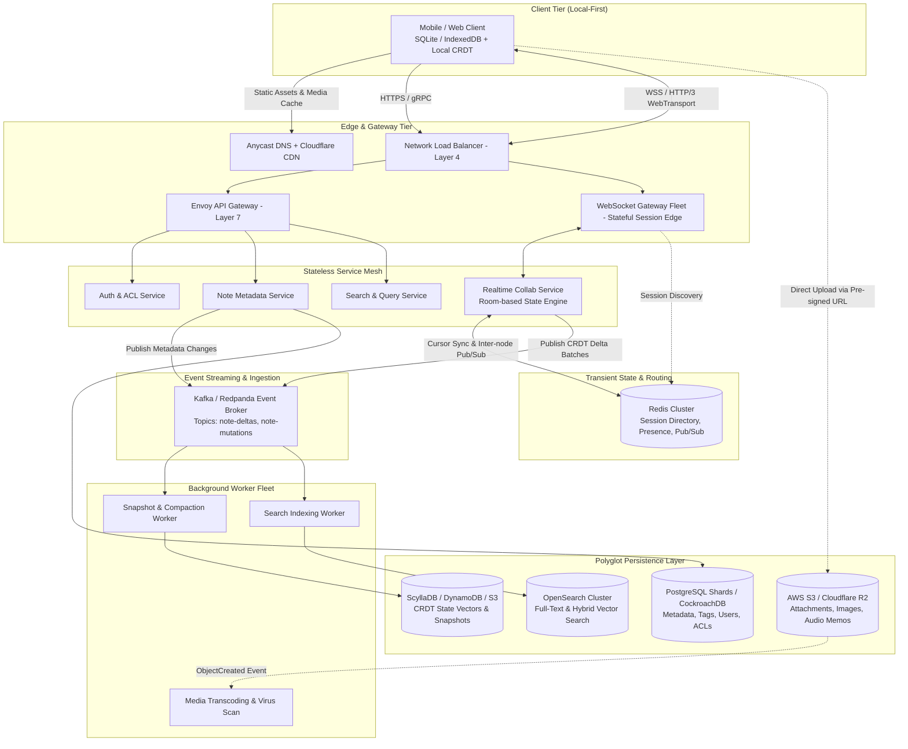

# 🏗️ Notes Application - System Design

Basically we will design The notes application And my goal is to make The Google And other note making applications
So in this system design What I'm thinking is Basically I will use my pro services architecture First of all then he kept here I'm trying to use consistency and politician tolerance Because what happen whenever We need to set the data across almost Which will be the persistent And I'm just not using availability and partition because What happened Tata across all the nodes should Same so for each user It should be consistent tough Instead Processing availability I am using the systems Okay and Yes I will use processor hours In the system design Architecture And data will be sharded Yes I will use

## System Design

## Keywords
Here is the complete revision guide covering all your keywords, organized strictly into 4 to 5 concise, actionable bullet points per concept in clean Markdown.

---

### Local-First Architecture

* **Definition:** An architectural paradigm where client devices read and write locally first before synchronizing with any server.
* **Zero Latency:** User actions execute instantly against an embedded local database without blocking on network round-trips.
* **Offline Sovereignty:** The application remains fully functional offline, holding full ownership of local data replicas.
* **Background Reconciliation:** Changes are reconciled asynchronously in the background once network connectivity is re-established.
* **Data Privacy:** Primary user data lives on the user's personal hardware rather than exclusively inside cloud datacenters.

### SQLite

* **Definition:** A self-contained, serverless, zero-configuration embedded relational SQL database engine running directly in-process.
* **Mobile/Desktop Storage:** Serves as the primary local persistence tier on iOS, Android, macOS, and Windows clients.
* **ACID Transactions:** Provides robust crash resilience and atomic local operations via Write-Ahead Logging (WAL) mode.
* **Query Performance:** Delivers sub-millisecond local reads and indexing without the overhead of network IPC or TCP connections.
* **Tooling & Ecosystem:** Integrates seamlessly with local-first sync abstractions like SQLite-WASM, PowerSync, and CR-SQLite.

### IndexedDB

* **Definition:** A low-level, transactional, client-side NoSQL key-value and object store built directly into modern web browsers.
* **Browser Persistence:** Provides large-capacity, structured client-side storage overcoming standard 5MB `localStorage` limits.
* **Asynchronous API:** Operates non-blockingly via DOM events and Promises, preventing UI frame drops during heavy storage I/O.
* **Indexed Queries:** Supports secondary indices, cursor iteration, and range scans across complex JavaScript document records.
* **WASM Acceleration:** Serves as the underlying durable storage driver for compiled SQLite-WASM web runtimes.

### CRDT (Conflict-Free Replicated Data Type)

* **Definition:** A mathematically verified distributed data structure that replicates across nodes and converges automatically without locks.
* **Mathematical Properties:** Update operations are commutative, associative, and idempotent ($A \cdot B = B \cdot A$), preventing merge conflicts.
* **Decentralized Edits:** Enables multiple users to edit the same rich-text paragraph concurrently across partitions without data loss.
* **Types:** Implemented either as Operation-based (Op-based) or State-based (CvRDT) data structures (e.g., Yjs, Automerge, LWW-Element-Set).
* **Deterministic Convergence:** Guarantees that every peer arriving at the same set of operations renders the exact same document.

### Anycast DNS

* **Definition:** A network addressing technique where a single destination IP address is announced simultaneously from multiple global locations.
* **Latency Reduction:** BGP (Border Gateway Protocol) routes client requests automatically to the topologically nearest point of presence (PoP).
* **DDoS Mitigation:** Absorbs distributed volumetric denial-of-service traffic by dispersing malicious packets across dozens of edge nodes.
* **Transparent Failover:** Automatically reroutes client traffic to alternative operational PoPs if a local data center goes offline.
* **Zero Client Logic:** Performs geographic routing entirely at Layer 3/4 without requiring DNS round-robin or client-side detection.

### Cloudflare CDN

* **Definition:** A globally distributed reverse-proxy network caching content and serving client traffic close to end-users.
* **Static Asset Caching:** Caches compiled web bundles (HTML, JS, CSS, WASM) and media files at edge nodes to offload origin servers.
* **DDoS & WAF Protection:** Inspects incoming Layer 7 traffic to block malicious exploits, botnets, and credential-stuffing attacks.
* **Edge SSL/TLS:** Terminates HTTPS connections close to users, cutting TCP/TLS handshake latency for subsequent requests.
* **Edge Workers:** Executes lightweight V8 isolates at the edge to perform localized routing, header rewriting, and token verification.

### Network Load Balancer (NLB)

* **Definition:** A high-throughput, ultra-low-latency load balancer operating at Layer 4 of the OSI model.
* **Extreme Scale:** Capable of handling millions of concurrent requests and active TCP/UDP connections per second with sub-millisecond latency.
* **Protocol Agnostic:** Forwards raw TCP, UDP, and TLS connections straight to target fleets without parsing HTTP payloads or inspecting headers.
* **Static IP Allocation:** Provides dedicated, deterministic Elastic IP addresses per Availability Zone for direct DNS record mapping.
* **Health Checking:** Continuously probes backend edge targets and removes unhealthy WebSocket or API gateways from rotation instantly.

### Layer 4 Load Balancing

* **Definition:** Traffic routing based strictly on network layer and transport layer information (Source/Dest IP, Source/Dest Port, TCP/UDP).
* **No Packet Inspection:** Avoids decrypting TLS or parsing HTTP/2 frames, resulting in minimal CPU overhead and blazing throughput.
* **Sticky Routing:** Leverages IP-hash or 5-tuple hash routing algorithms to keep TCP streams tied to the same ingress machine.
* **Stateful Edge Feeder:** Acts as the ideal initial traffic distribution layer for long-lived, stateful WebSocket and WebTransport connections.
* **Failover Speed:** Rebalances raw transport connections instantaneously upon detecting backend node failures.

### Envoy API Gateway

* **Definition:** A high-performance, open-source C++ edge and service proxy designed specifically for cloud-native microservice architectures.
* **Layer 7 Intelligence:** Inspects HTTP/gRPC paths, query params, and JWT headers to route requests to precise upstream internal services.
* **Traffic Management:** Implements production-grade resilience primitives including rate limiting, circuit breaking, timeouts, and retries.
* **Observability Anchor:** Emits standardized distributed tracing headers (W3C Trace Context, OpenTelemetry) and Prometheus metrics.
* **Dynamic Configuration:** Updates routing rules, clusters, and listeners on the fly without downtime via gRPC-based dynamic xDS APIs.

### Layer 7 Load Balancing

* **Definition:** Traffic routing performed at the Application Layer (OSI Layer 7), inspecting application data like HTTP headers, cookies, and URIs.
* **Content-Based Routing:** Routes traffic intelligently based on request paths (e.g., `/api/v1/auth` vs `/api/v1/notes` vs `/ws`).
* **TLS Termination:** Decrypts inbound SSL/TLS sessions at the gateway, relieving internal microservices of heavy cryptographic computation.
* **Authentication Offloading:** Validates incoming Bearer JWT tokens and checks permission headers before forwarding requests to internal services.
* **Payload Compression:** Compresses outbound API response payloads dynamically using modern algorithms like Gzip and Brotli.

### WebSocket Gateway

* **Definition:** A specialized edge proxy fleet optimized to maintain and manage hundreds of thousands of concurrent, bidirectional TCP sockets.
* **Protocol Upgrade:** Upgrades inbound HTTP/1.1 or HTTP/2 GET upgrade requests into persistent, bidirectional full-duplex WebSocket frames.
* **Edge Decoupling:** Shields internal stateless core microservices from holding persistent, idle client network socket state.
* **Connection Lifecycle:** Manages ping/pong heartbeat pings to detect zombie client connections and cleans up disconnected socket allocations.
* **Framing & Serialization:** Translates raw inbound WebSocket binary CRDT deltas into internal pub/sub messages or gRPC payloads.

### Stateful Sessions

* **Definition:** A connection design where an edge server maintains persistent, in-memory state and socket handles tied to a specific client.
* **Bidirectional Flow:** Enables servers to push real-time updates directly to clients instantly without polling or long-pull delays.
* **Connection Overhead:** Demands careful resource management (file descriptors, socket memory buffers) per active connected client.
* **Sticky Association:** Requires distributed discovery registries to locate which specific gateway node holds the socket for a given user.
* **Graceful Draining:** Requires blue/green draining strategies during deployments to avoid dropping thousands of live sessions at once.

### HTTPS

* **Definition:** Hypertext Transfer Protocol Secure; standard HTTP encrypted end-to-end via Transport Layer Security (TLS/SSL).
* **Cryptographic Security:** Guarantees data confidentiality, integrity, and non-repudiation between the client browser and the API gateway.
* **Handshake Negotiation:** Authenticates server identities using X.509 PKI certificates and negotiates symmetric session keys (AES-GCM, ChaCha20).
* **Stateless API Queries:** Serves as the standard transport layer for metadata fetches, user profile management, and account settings.
* **HTTP/2 Multiplexing:** Transports multiple parallel concurrent requests and responses over a single shared underlying TCP connection.

### gRPC

* **Definition:** A high-performance, open-source, universal RPC framework developed by Google utilizing HTTP/2 transport and Protocol Buffers.
* **Binary Serialization:** Uses strongly typed, pre-compiled `.proto` schemas to serialize binary payloads far smaller and faster than JSON.
* **Multiplexed Streaming:** Supports unary calls, client streaming, server streaming, and bidirectional streaming over persistent HTTP/2 frames.
* **Internal Inter-Service Mesh:** Acts as the primary low-latency transport protocol for internal synchronous communication between microservices.
* **Strict Contracts:** Enforces compile-time type safety across multiple programming languages, eliminating schema drift between services.

### WebSocket

* **Definition:** A standardized computer communications protocol providing persistent, full-duplex, bidirectional communication channels over a single TCP connection.
* **Minimal Frame Overhead:** Operates with just 2 to 10 bytes of frame overhead per message, contrasting drastically with heavyweight HTTP request headers.
* **Realtime Delivery:** Enables the server to push character-level document changes, typing cursors, and presence events to clients with sub-10ms latency.
* **Browser Native:** Fully supported across all modern web browsers and mobile platforms without external runtime dependencies.
* **Stateful Socket Management:** Demands specialized edge gateway layers capable of maintaining high-concurrency connection loops and heartbeats.

### HTTP/3

* **Definition:** The third major version of the Hypertext Transfer Protocol, running over QUIC (UDP) rather than traditional TCP.
* **Head-of-Line Blocking Fix:** Prevents packet loss on one stream from stalling all other multiplexed streams inside the connection.
* **0-RTT Connection Establishment:** Combines cryptographic and transport handshakes to resume encrypted connections in zero round trips.
* **Connection Migration:** Maintains active sessions seamlessly when client devices switch networks (e.g., jumping from Wi-Fi to mobile 5G).
* **Modern Ingress:** Drastically accelerates dynamic content delivery, API payloads, and initial handshakes under lossy, high-jitter networks.

### WebTransport

* **Definition:** A modern web API providing low-latency, bidirectional, client-server messaging built on top of the HTTP/3 and QUIC protocol suite.
* **Flexible Semantics:** Supports both reliable ordered/unordered byte streams and unreliable datagrams within the same single connection.
* **WebSocket Successor:** Delivers real-time bidirectional messaging while bypassing TCP head-of-line blocking bottlenecks on lossy networks.
* **Unreliable Messaging:** Allows transmitting loss-tolerant transient updates (like live mouse cursor tracks) via lightweight datagrams.
* **Wasm & Worker Friendly:** Operates seamlessly inside background Web Workers, isolating network ingestion away from browser main UI threads.

### Stateless Services

* **Definition:** Application services that do not retain client session state or persistent data in local memory across consecutive requests.
* **Trivial Horizontal Scaling:** Instances can be spawned, autoscaled, or terminated behind load balancers instantly based on CPU/memory load.
* **Failure Isolation:** The crash or termination of any individual container has zero impact on user session continuity or data integrity.
* **Externalized Persistence:** All durable state, session records, and shared data are delegated to external databases, caches, or message buses.
* **Immutable Deployments:** Simplifies rolling updates, canary rollouts, and blue/green deployments across Kubernetes worker nodes.

### Service Mesh

* **Definition:** A dedicated infrastructure layer injected alongside microservices to control, secure, and monitor service-to-service communication.
* **Sidecar Proxying:** Deploys lightweight sidecars (e.g., Envoy, Linkerd) next to each microservice container to intercept all network traffic.
* **Mutual TLS (mTLS):** Enforces cryptographic zero-trust identity verification and end-to-end encryption automatically between all internal pods.
* **Traffic Control:** Orchestrates canary traffic splitting, automatic circuit breaking, blue/green weight routing, and transparent retries.
* **Uniform Telemetry:** Captures standardized golden signals (latency, traffic, errors, saturation) and distributed tracing spans across all nodes.

### Authentication

* **Definition:** The process of cryptographically verifying the identity of a user, service, or machine attempting to access the system.
* **Token-Based Protocols:** Employs cryptographically signed JSON Web Tokens (JWT) or opaque session tokens issued via OAuth 2.0 and OIDC flows.
* **Stateless Token Verification:** Downstream microservices verify signed JWT cryptographic claims locally using cached public RSA/ECDSA keys.
* **Credential Protection:** Hashes passwords using modern, memory-hard algorithms like Argon2id or bcrypt before persistent storage.
* **Multi-Factor Auth (MFA):** Enforces secondary verification mechanisms including TOTP, FIDO2 WebAuthn hardware keys, and passkeys.

### Authorization

* **Definition:** The security mechanism determining what specific actions an authenticated identity is permitted to perform on a given resource.
* **Principle of Least Privilege:** Restricts users and service roles to the absolute bare minimum set of read, write, and administrative rights.
* **Policy Enforcement:** Evaluates security policies at the API Gateway or individual domain service levels prior to business execution.
* **Fine-Grained Context:** Assesses situational attributes including user ownership, organization membership, and operational status.
* **Separation of Concerns:** Decouples policy verification code from core business algorithms using engines like Open Policy Agent (OPA).

### ACL (Access Control List)

* **Definition:** A table or data structure that pairs an individual resource directly with a list of identities and their precise privileges.
* **Note App Roles:** Maps users to explicit hierarchical roles on documents: `viewer`, `commenter`, `editor`, and `admin`.
* **Inheritance Models:** Allows workspace-level permissions to cascade automatically to nested folders and individual child documents.
* **Fast Permission Checks:** Cached heavily inside Redis or localized memory caches to avoid querying relational databases on every delta write.
* **Revocation Speed:** Requires immediate cache invalidation across distributed edge layers when a collaborator's access is revoked.

### Realtime Collaboration

* **Definition:** A concurrent multi-user system allowing several participants to edit the same digital document simultaneously with sub-second feedback.
* **Optimistic Local Reflection:** Changes render locally on the author's screen instantly while being dispatched asynchronously to peers.
* **Conflict Reconciliation:** Employs mathematical frameworks (CRDTs or Operational Transformation) to merge concurrent edits deterministically.
* **Live Presence Integration:** Displays the real-time presence, selections, and relative cursor coordinates of other active collaborators.
* **Low Latency Budget:** Demands end-to-end network transmission and rendering cycles under 100 milliseconds to preserve user fluidity.

### Room-Based Architecture

* **Definition:** A logical partitioning pattern where real-time collaboration engines organize active client connections by distinct document contexts ("rooms").
* **Collab Clustering:** All users viewing or editing `note_123` join `room_123`, scoping all broadcast operations strictly to that document's peers.
* **Memory Isolation:** Loads document CRDT state models into server memory only while active users inhabit the room, unloading upon vacancy.
* **Scoped Pub/Sub:** Uses room IDs as partition keys or channel names in message brokers, preventing cluster-wide broadcast flooding.
* **Graceful Lifecycle:** Handles room spin-up, state hydration from cold storage, delta streaming, and snapshot flushing upon room teardown.

### Redis Cluster

* **Definition:** A distributed, sharded implementation of Redis providing high-performance, in-memory key-value caching and message brokering.
* **Data Sharding:** Partitions keys automatically across 16,384 hash slots distributed among multiple master and replica nodes.
* **Sub-Millisecond Speed:** Serves in-memory read and write operations at ultra-low microsecond-level latency profiles.
* **High Availability:** Automatically detects master node failures and promotes slave replicas using internal Raft-like consensus voting.
* **Core Realtime Backbone:** Acts as the shared state backbone for session discovery, transient presence states, and real-time Pub/Sub queues.

### Session Directory

* **Definition:** An ephemeral, highly available distributed lookup table mapping active client connections to their host gateway instances.
* **Routing Lookup:** Given a user or document ID, identifies exactly which physical WebSocket Gateway node holds the client's open socket.
* **TTL-Backed Leases:** Employs expiring keys with periodic heartbeats, guaranteeing that crashed server instances are purged automatically.
* **Fast Inter-Server Routing:** Enables internal microservices to forward real-time push notifications to the exact server hosting the user.
* **Horizontal Scalability:** Eliminates the need for edge gateways to broadcast messages to every node in the cluster blindly.

### Presence

* **Definition:** A real-time awareness subsystem tracking transient collaborator state such as who is currently active in a specific document.
* **Transient Data:** Carries ephemeral information (e.g., "Alice is online", user avatar, active focus pane) that does not require long-term storage.
* **Heartbeat Keep-Alives:** Periodically refreshes presence keys in an in-memory cache; absence of a ping marks the user offline immediately.
* **Low Reliability Guarantee:** Can safely be dropped under extreme network congestion without corrupting the durable state of the document.
* **Delta Broadcasts:** Pushes joined, departed, and idle events to all members of a document room via the collaboration pub/sub layer.

### Pub/Sub (Publish/Subscribe)

* **Definition:** An asynchronous messaging pattern where senders (publishers) categorize messages into channels without knowledge of specific receivers (subscribers).
* **Decoupled Architecture:** Completely separates the lifecycle and operational dependencies of event producers from downstream consumers.
* **Dynamic Fan-Out:** Delivers a single document update published by one collaboration worker to hundreds of connected room listeners instantly.
* **In-Memory Engines:** Uses Redis Pub/Sub or NATS for transient, low-latency messaging where durable persistence is not required.
* **Scalable Communication:** Coordinates inter-node synchronization across disparate stateless WebSocket gateway instances seamlessly.

### Session Discovery

* **Definition:** The discovery mechanism that maps dynamic, distributed stateful connections to enable targeted message forwarding.
* **Eliminates Broadcast Storms:** Prevents edge gateway fleets from blindly broadcasting messages to every server across the entire data center.
* **Registry Lookups:** Queries distributed registries (like Redis or DynamoDB Accelerator) to fetch the network address of target nodes.
* **Dynamic Updates:** Updates routing tables instantaneously whenever a mobile device disconnects, changes networks, or reconnects.
* **Stateful Coordination:** Essential for coordinating WebRTC signaling, WebSocket frame targeting, and peer-to-peer collaboration clusters.

### Inter-Node Communication

* **Definition:** Network communication protocols and data exchange pipelines operating between disparate nodes within an internal cluster.
* **High Efficiency:** Uses optimized, low-overhead binary protocols such as gRPC, raw TCP sockets, or distributed shared memory.
* **Cluster Topologies:** Structured as full meshes, gossip networks (e.g., HashiCorp Serf), or broker-centric hubs depending on scale.
* **State Synchronization:** Propagates node membership updates, cluster metrics, leadership elections, and configuration changes.
* **Low Latency Target:** Runs inside private Virtual Private Clouds (VPCs) across high-bandwidth (100Gbps+) internal data center backbones.

### Cursor Synchronization

* **Definition:** The real-time broadcasting and rendering of collaborators' mouse cursor coordinates, text selections, and scroll positions.
* **Ephemeral Stream:** Treated as loss-tolerant data; dropped packets are ignored in favor of the most recent coordinate frame.
* **Debounced Broadcasting:** Client throttle logic clamps cursor updates to roughly 30–60 updates per second to conserve outbound bandwidth.
* **Relative Positioning:** Uses relative document indices or anchor offsets rather than absolute screen coordinates to account for different screen sizes.
* **Visual Identity:** Packages cursor frames with distinct color codes, user names, and avatar IDs for UI rendering.

### Event Streaming

* **Definition:** The continuous, real-time ingestion, processing, and routing of boundless streams of time-stamped events as they occur.
* **Append-Only Architecture:** Records changes as an immutable sequence of historical facts, preserving a complete audit trail.
* **Decoupled Consumers:** Enables multiple independent consumer groups to read and process the same stream at their own individual pace.
* **Backpressure Buffer:** Protects downstream databases and internal workers from crashing during sudden massive traffic surges.
* **Replayability:** Allows new or recovering microservices to replay past events from historical offsets to rebuild application state.

### Apache Kafka

* **Definition:** An open-source distributed event streaming platform built for high-throughput, fault-tolerant, low-latency data pipelines.
* **Partitioned Commit Log:** Distributes topic logs across multiple broker partitions, enabling immense parallel read and write concurrency.
* **Disk-Backed Durability:** Persists serialized records to disk with configurable retention policies and replicates data across broker clusters.
* **Consumer Groups:** Coordinates distributed consumer instances to divide partition processing workloads dynamically with automatic rebalancing.
* **Zero-Copy Optimization:** Leverages the Linux OS page cache and `sendfile` system call to stream network packets directly without JVM memory copies.

### Redpanda

* **Definition:** A high-throughput, modern streaming data platform designed as a drop-in, C++ native alternative to Apache Kafka.
* **Zero JVM Overhead:** Eliminates Java Virtual Machine garbage collection pauses, delivering predictable, ultra-low p99 latency profiles.
* **No External Dependencies:** Built without Apache ZooKeeper or KRaft dependencies, bundling self-contained Raft consensus natively.
* **Kafka API Compatible:** Works out of the box with existing Kafka client libraries, connectors, ecosystem tools, and dashboards.
* **Hardware Efficiency:** Uses a thread-per-core asynchronous architecture to maximize modern NVMe SSD and multi-core CPU throughput.

### Event Broker

* **Definition:** An infrastructure middleware component responsible for receiving, queuing, persisting, and routing event payloads.
* **Decoupling Producers & Consumers:** Bridges asynchronous workflows so services producing data never interact with consumer runtimes directly.
* **Message Routing:** Distributes inbound messages based on topic names, partition keys, event types, or explicit header metadata.
* **Delivery Guarantees:** Enforces configurable quality of service parameters, such as at-least-once or exactly-once message deliveries.
* **State Retention:** Preserves messages for set durations or capacity thresholds, allowing asynchronous offline consumers to catch up cleanly.

### Event-Driven Architecture (EDA)

* **Definition:** A software design pattern where decoupled microservices react asynchronously to emitted state change notifications ("events").
* **Loose Coupling:** Services remain entirely unaware of the existence, number, or implementation details of downstream consumers.
* **Extensibility:** New business functionality (e.g., analytics, push notifications) is added by attaching new consumers without modifying producers.
* **Asynchronous Execution:** Prevents blocking user requests; slow tasks are handed off to background worker pipelines immediately.
* **Eventual Consistency:** Employs eventual consistency across disparate service boundaries rather than distributed ACID locks.

### CRDT Delta Batching

* **Definition:** The technique of accumulating multiple fine-grained CRDT operations over a brief time window before transmission or disk write.
* **I/O Amortization:** Combines dozens of individual character keystroke operations into a single combined payload, slashing database I/O costs.
* **Network Conservation:** Reduces packet header overhead over WebSockets and internal message buses by avoiding microscopic frames.
* **Debounced Persistence:** Flushes pending in-memory delta buffers to Kafka or databases only after a sliding debounce window ($t = 2\text{s}$).
* **Crash Resilience:** Unflushed in-memory batches are backed by local client storage, ensuring zero data loss if an edge node terminates.

### PostgreSQL

* **Definition:** A powerful, enterprise-grade, open-source object-relational database management system known for reliability and feature robustness.
* **Strict ACID Compliance:** Guarantees absolute consistency, serializability, and durability for critical structural workspace records.
* **Rich Data Types:** Native support for JSONB, UUIDs, arrays, full-text search dictionaries, and spatial extensions (PostGIS).
* **Advanced Indexing:** Features comprehensive indexing strategies including B-Trees, Generalized Inverted Indexes (GIN), GiST, and BRIN.
* **Extensible Ecosystem:** Integrates seamlessly with replication, sharding (Citus), and Change Data Capture pipelines (Debezium).

### Database Sharding

* **Definition:** A horizontal database partitioning pattern that splits large data sets across multiple distinct, independent database servers.
* **Horizontal Scalability:** Overcomes CPU, RAM, and disk I/O limits of single primary database servers by distributing the storage load.
* **Shard Keys:** Selects deterministic columns (e.g., `workspace_id`, `user_id`) to route queries directly to the correct shard instance.
* **Eliminating Cross-Shard Joins:** Co-locates related tables on the same physical shard to execute fast, localized relational queries.
* **Operational Complexity:** Demands custom schema migrations, shard rebalancing, and careful monitoring against data skew and hot shards.

### CockroachDB

* **Definition:** A cloud-native, distributed SQL database engineered for automatic horizontal scalability and multi-region survivability.
* **PostgreSQL Wire Compatible:** Interoperates with standard PostgreSQL client drivers, ORMs, and query conventions out of the box.
* **Raft Consensus:** Employs the Raft consensus algorithm across ranges of data to provide strict serializable ACID consistency (CP-oriented).
* **Automatic Rebalancing:** Automatically splits, moves, and re-replicates data ranges across nodes when new infrastructure is added.
* **Multi-Region Disaster Recovery:** Survives localized data center outages without data loss or manual failover intervention.

### ScyllaDB

* **Definition:** An ultra-high-performance, distributed NoSQL wide-column database written in C++, acting as a drop-in Apache Cassandra alternative.
* **Thread-per-Core Architecture:** Maximizes hardware utilization by dedicating threads to specific CPU cores, eliminating locking and context switching.
* **Predictable Latency:** Delivers sub-millisecond p99 response times while processing hundreds of thousands of operations per node per second.
* **Partitioned Wide-Column Model:** Partition key (`note_id`) and clustering key (`version`) provide optimal read paths for document snapshots.
* **Masterless Replication:** Features a decentralized, ring-based peer architecture eliminating single points of failure across the cluster.

### DynamoDB

* **Definition:** A fully managed, serverless NoSQL database service from AWS offering consistent single-digit millisecond latency at any scale.
* **Zero Operational Overhead:** Handles hardware provisioning, setups, setup patching, replication, and cluster scaling automatically.
* **Partition Key Design:** Routes reads and writes deterministically across storage partitions using hash-based partition keys.
* **Flexible Schemas:** Accommodates variable JSON document structures and binary data blobs up to 400KB per individual item.
* **Global Tables:** Provides fully managed, multi-region active-active replication to serve localized reads and writes across global users.

### Amazon S3

* **Definition:** An industry-standard, highly durable, internet-facing object storage service developed and managed by Amazon Web Services.
* **Extreme Durability:** Delivers 99.999999999% (11 9s) of data durability across multiple geographically separated Availability Zones.
* **Unlimited Capacity:** Stores virtually limitless volumes of unstructured data, handling files ranging from 1 byte up to 5 terabytes each.
* **Storage Tiering:** Features automated lifecycle policies to transition aged media assets into cheaper cold tiers (Glacier / Deep Archive).
* **Security & Control:** Governs access through IAM policies, bucket ACLs, pre-signed URLs, and automatic SSE-S3/KMS encryption.

### Cloudflare R2

* **Definition:** An S3-compatible, distributed object storage service designed to eliminate bandwidth and egress data-transfer charges completely.
* **Zero Egress Fees:** Allows applications to retrieve and serve stored media assets, images, and backups without punitive bandwidth costs.
* **Global Ingress:** Seamlessly integrated with Cloudflare's global edge network, routing uploads to the nearest available object storage bucket.
* **S3 API Compatibility:** Works with existing AWS S3 SDKs, tools, and libraries by simply swapping the endpoint and access credentials.
* **Low Latency Access:** Pairs natively with Cloudflare Workers to transform, cache, and authenticate objects directly at the network edge.

### Object Storage

* **Definition:** A data storage architecture that manages data as distinct, discrete objects rather than as file hierarchies or relational rows.
* **Flat Organization:** Stores objects within a flat namespace paired with unique identifier keys, extensible metadata tags, and binary data payloads.
* **Unstructured Data Fit:** The industry-standard storage medium for media assets, attachments, video memos, PDFs, and compressed backups.
* **Massive Parallelism:** Scales read and write operations horizontally across vast clusters without complex locking or database indexing.
* **Cost Efficiency:** Dramatically cheaper per gigabyte than high-speed relational block storage (EBS) or distributed database disks.

### OpenSearch

* **Definition:** An open-source, distributed search and analytics suite derived from Elasticsearch, engineered for high-performance retrieval.
* **Inverted Indexes:** Builds tokenized inverted indexes allowing sub-second full-text searching across millions of large rich-text notes.
* **Distributed Sharding:** Distributes search indexes across primary and replica shards, scaling search throughput horizontally.
* **Rich Filtering:** Combines full-text search queries with structured boolean metadata filters (tags, folder IDs, date ranges).
* **Vector Engine:** Supports approximate k-nearest neighbor (k-NN) search to power modern semantic and AI-driven retrieval workloads.

### Full-Text Search

* **Definition:** A retrieval technique that parses, tokenizes, and indexes complete natural language text documents to match arbitrary search phrases.
* **Linguistic Analysis:** Employs language-specific analyzers to handle word tokenization, lowercasing, stop-word removal, and stemming (e.g., "running" $\to$ "run").
* **Fuzzy Matching:** Accommodates user typos and misspellings using Levenshtein distance calculations on inverted index terms.
* **Relevance Scoring:** Ranks search results quantitatively using modern information retrieval algorithms such as BM25 or TF-IDF.
* **Highlighting:** Pinpoints and extracts the exact text snippets containing query terms for display in user application interfaces.

### Hybrid Search

* **Definition:** A search architecture combining traditional keyword-based lexical search (BM25) with modern vector-based semantic search.
* **Best of Both Worlds:** Merges exact keyword matching (SKUs, proper names, error logs) with contextual conceptual understanding.
* **Reciprocal Rank Fusion (RRF):** Normalizes and combines the rank scores of both retrieval methods to output a single coherent results list.
* **Domain Adaptability:** Fixes the blind spots of vector search (jargon, numbers) while eliminating the rigid keyword limits of text search.
* **Production Standard:** The standard search design for enterprise knowledge bases, modern note tools, and generative AI platforms.

### Vector Search

* **Definition:** A search methodology that indexes text as high-dimensional mathematical coordinate embeddings to match semantic intent.
* **Dense Embeddings:** Converts raw document paragraphs and user queries into numerical vectors using deep learning models (e.g., text-embedding-3).
* **Semantic Proximity:** Calculates similarity using vector distance metrics (Cosine Similarity, Euclidean Distance, Dot Product).
* **Approximate k-NN:** Leverages indexing algorithms like HNSW (Hierarchical Navigable Small World) to query high-dimensional vectors in milliseconds.
* **Concept Matching:** Successfully matches user queries even when the searched document contains completely different vocabulary with identical meaning.

### Background Workers

* **Definition:** Autonomous background service processes that execute non-interactive, long-running, or asynchronous jobs outside the main API thread.
* **Resource Isolation:** Prevents computationally heavy tasks (media transcoding, virus scans) from starving critical client-facing web servers.
* **Queue-Driven Work:** Polls or consumes tasks continuously from distributed message queues like Kafka, RabbitMQ, or Amazon SQS.
* **Independent Scalability:** Autoscale worker fleets independently based on queue depth metrics rather than incoming web request volumes.
* **Fault Recovery:** Supports automated retries, idempotent re-executions, and dead-letter queue routing upon unhandled task crashes.

### Asynchronous Processing

* **Definition:** A computing execution pattern where a program kicks off an operation without waiting for it to complete before moving to the next task.
* **Non-Blocking APIs:** Allows the API Gateway to acknowledge user requests immediately ($202\text{ Accepted}$) while the actual job processes in the background.
* **System Resiliency:** Shields client interactions from downstream service slowness, network hiccups, and temporary database outages.
* **Traffic Smoothing:** Absorbs massive spikes in user submissions by staging them in durable buffers for steady, controlled consumption.
* **Decoupled Workflows:** Simplifies complex multi-step pipelines (e.g., upload $\to$ scan $\to$ transcode $\to$ index) into staged event triggers.

### Snapshot

* **Definition:** A full, self-contained capture of an entity's complete consolidated state taken at a single specific instant in time.
* **Compaction Checkpoint:** Condenses thousands of fine-grained, incremental CRDT or Event Sourcing deltas into a single point-in-time document state.
* **Fast Bootstrapping:** Allows newly connected clients to load a single snapshot payload rather than sequentially replaying years of historical operations.
* **Cold Storage Optimization:** Serializes consolidated document state into compressed binary buffers (Protobuf/JSONB) stored safely in Object Storage.
* **Disaster Recovery:** Serves as the baseline recovery point for databases and document stores during major infrastructure restores.

### Compaction

* **Definition:** The maintenance process of purging obsolete historical records, deleted data, and redundant update logs to reclaim disk space.
* **Log Compaction:** Keeps only the most recent state change per record key in an event log, trimming superseded intermediate states.
* **CRDT Compaction:** Identifies and garbage-collects obsolete delete markers (tombstones) once all client nodes have synchronized past that point.
* **I/O Optimization:** Merges fragmented on-disk database structures (e.g., LSM-Tree SSTables) to accelerate read queries.
* **Storage Reduction:** Prevents append-only document systems from continuously consuming unbounded storage over years of rapid revisions.

### Search Indexing

* **Definition:** The asynchronous process of parsing, analyzing, and structuring document text into optimized search engine structures.
* **Decoupled Pipeline:** Triggered asynchronously via event streams (Kafka) to ensure document edit performance is never blocked by search updates.
* **Token Extraction:** Strips HTML/Markdown markup, parses plain text, breaks sentences into terms, and generates semantic vector embeddings.
* **Bulk Indexing:** Accumulates and indexes document mutations in batches to optimize bulk ingestion throughput on OpenSearch clusters.
* **Near-Real-Time (NRT):** Updates search visibility typically within 1 to 2 seconds of the document edit being persisted to disk.

### Media Transcoding

* **Definition:** The automated process of decoding, re-encoding, and formatting user-uploaded media files into standardized, web-optimized formats.
* **Format Standardization:** Converts raw, proprietary mobile camera formats (HEIC, Apple Lossless) into universal standards (JPEG, WebP, MP4, AAC).
* **Multi-Resolution Generation:** Employs tools like FFmpeg to generate low-res thumbnails, mobile previews, and standard resolutions for responsive UI display.
* **Bandwidth Optimization:** Compresses high-resolution images and oversized video/audio memos to save client bandwidth and storage costs.
* **Asynchronous Offloading:** Executed by background worker fleets to prevent high CPU utilization from degrading API gateway performance.

### Virus Scanning

* **Definition:** The automated security inspection of all user-uploaded files to detect and quarantine malware, trojans, and malicious payloads.
* **Pipeline Quarantine:** Marks newly uploaded files as isolated in object storage until an automated scanning worker confirms they are clean.
* **Scanning Engines:** Employs headless scanning daemons (e.g., ClamAV) and third-party threat intelligence APIs to evaluate file signatures.
* **Zero Trust:** Inspects all attachments—including images, PDFs, and archives—regardless of who uploaded them or their authorization role.
* **Asynchronous Execution:** Runs parallel to the upload confirmation, alerting the user and removing the file only if an infection is discovered.

### Direct Upload

* **Definition:** An architectural pattern allowing clients to upload large binary assets directly to object storage, bypassing application API servers.
* **Eliminates Gateway Saturation:** Prevents gigabytes of binary payload data from clogging API Gateway bandwidth, memory buffers, and threads.
* **Maximized Speeds:** Transfers files straight to nearby cloud storage edge endpoints using optimized multi-part parallel connections.
* **Decoupled Workflow:** The API server handles only cheap metadata verification and returns signed tokens, staying light and responsive.
* **Cost Efficiency:** Drastically cuts network data transfer and compute costs across the microservice application cluster.

### Presigned URL

* **Definition:** A cryptographically signed, time-limited URL granting temporary direct read or write access to a specific cloud object storage path.
* **Zero Infrastructure Proxies:** Allows clients to upload directly to S3 or Cloudflare R2 without routing binary data through application backends.
* **Strict Security Constraints:** Encodes the target bucket, file key, allowed HTTP verbs (PUT/POST), expiration timestamps, and content-type restrictions.
* **Cryptographic Verification:** Cloud object storage verifies the signature against cloud provider IAM secret keys without contacting the app server.
* **Short-Lived Tokens:** Configured to expire within minutes (e.g., 5–15 mins), minimizing the attack window if a URL is intercepted.

### ObjectCreated Event

* **Definition:** A cloud storage notification event emitted automatically when a new file upload finishes writing to an object storage bucket.
* **Asynchronous Integration:** Serves as the initial trigger for downstream processing pipelines without requiring the client to ping the backend twice.
* **Event Payloads:** Carries metadata including bucket name, object key path, file size, content type, and ETag checksum hashes.
* **Decoupled Routing:** Forwards storage events through cloud message buses (Amazon S3 Event Notifications $\to$ SNS/SQS/Kafka).
* **Downstream Fan-Out:** Fans out the notification simultaneously to media transcoders, virus scanners, and search indexing workers.

### Event-Driven Processing

* **Definition:** Executing business workflows reactively in response to consumed events rather than through synchronous, top-down instruction chains.
* **State Decoupling:** Each processing worker performs a single discrete task, emits its own completion event, and cleanly exits.
* **Dynamic Pipeline Growth:** New processing stages (e.g., OCR extraction) are attached simply by subscribing to existing pipeline completion events.
* **Self-Healing Faults:** Failed processing stages are retried independently using dead-letter queues without halting the broader system.
* **High Concurrency:** Workers scale out to process bursts of concurrent inbound events in parallel across compute clusters.

### Data Replication

* **Definition:** The process of continuously copying and synchronizing data across multiple physical storage servers or geographic data centers.
* **High Availability:** Guarantees that data remains accessible for reads and writes even if primary database hardware crashes completely.
* **Disaster Recovery:** Replicates data across different cloud regions to survive regional power outages or natural disasters.
* **Read Throughput Scaling:** Distributes read traffic across multiple read-replicas, relieving pressure on the write-master database.
* **Replication Topologies:** Implemented via Single-Leader (Primary-Replica), Multi-Leader (Active-Active), or Leaderless (Quorum) models.

### Eventual Consistency

* **Definition:** A consistency model in distributed systems guaranteeing that, given no new updates, all replicas will eventually yield identical data.
* **AP System Foundation:** Prioritizes high availability and partition tolerance over strict, immediate read-after-write locking across all nodes.
* **Temporary Inconsistency:** Accepts that different users may view slightly divergent states for a brief window ($t < 1\text{s}$) during concurrent edits.
* **Convergence Guarantee:** Relies on deterministic conflict resolution mechanisms (such as CRDTs or LWW) to merge states smoothly.
* **Massive Scale Enabler:** Eliminates heavy, slow cross-datacenter two-phase commits (2PC), unlocking massive horizontal scale.

### Distributed Systems

* **Definition:** A collection of autonomous computing entities communicating over a network that coordinate actions to appear as a single unified system.
* **No Shared Memory:** Nodes operate with independent local memory and communicate exclusively via asynchronous network packet exchanges.
* **Concurrency & Parallelism:** Handles immense workloads by dividing data and computational tasks across dozens to thousands of machines.
* **Partial Failure Reality:** Architected on the baseline assumption that individual components, disks, and network links can and will fail randomly.
* **Coordination Challenges:** Demands sophisticated consensus protocols (Raft, Paxos) to agree on shared system states, leases, and configurations.

### Horizontal Scaling

* **Definition:** The practice of expanding system capacity by adding more operational nodes to the system pool rather than upgrading hardware.
* **Elastic Autoscaling:** Spawns and kills commodity compute instances dynamically in real time based on observed CPU, memory, and queue load.
* **Cost Efficiency:** Leverages cheaper commodity hardware instances rather than paying exponential costs for massive enterprise mainframes.
* **No Single Bottleneck:** Eliminates architectural ceilings; throughput scales near-linearly by distributing traffic across the fleet.
* **Requires Statelessness:** Works best when application services are stateless, delegating shared state to dedicated storage tiers.

### Load Balancing

* **Definition:** The systematic distribution of inbound network traffic across a pool of backend servers to prevent any single machine from overloading.
* **Resource Optimization:** Maximizes throughput, minimizes response latency, and prevents server saturation across the infrastructure.
* **Health Monitoring:** Routinely monitors backend server endpoints, pulling crashed or degraded instances out of the active routing pool.
* **Routing Algorithms:** Employs strategies such as Round Robin, Least Connections, Weighted Hash, and IP/Session Affinities.
* **Redundancy & Failover:** Configured in redundant pairs to eliminate single points of failure at traffic ingress checkpoints.

### Caching

* **Definition:** The practice of storing copies of frequently accessed data in high-speed, temporary storage layers for rapid subsequent retrieval.
* **Latency Reduction:** Serves queries from ultra-fast in-memory stores (e.g., Redis, Memcached) instead of hitting slower relational disks.
* **Database Offloading:** Shields core persistence databases from repetitive read traffic, saving CPU cycles for heavy transactional writes.
* **Cache Eviction Policies:** Manages memory limits through automatic eviction strategies such as Least Recently Used (LRU) or Time-to-Live (TTL).
* **Caching Tiers:** Implemented across multiple architectural boundaries: browser-side, CDN edge, API gateway, and internal service layers.

### Fault Tolerance

* **Definition:** The architectural capability of a system to continue functioning correctly and reliably in the event of component failures.
* **Redundancy Design:** Eliminates all single points of failure (SPOFs) by duplicating critical compute nodes, networks, and databases.
* **Graceful Degradation:** Continues serving core workflows (e.g., reading/writing notes) even if auxiliary services (e.g., search indexing) crash.
* **Self-Healing Systems:** Automatically detects unhealthy nodes, restarts failing pods, and re-routes active traffic via orchestration platforms.
* **Chaos Engineering:** Verified and hardened using proactive failure injection (e.g., Chaos Mesh, Chaos Monkey) against live environments.

### High Availability (HA)

* **Definition:** A systems design characteristic aimed at ensuring an agreed level of operational performance and uptime over a prolonged period.
* **Uptime Standard:** Quantified using "nines" of availability (e.g., 99.99% "four nines" permits only 52.6 minutes of downtime per calendar year).
* **Geographic Redundancy:** Deploys active infrastructure across multiple independent physical Availability Zones (AZs) and cloud regions.
* **Automated Failover:** Uses health checks and automated DNS or routing failovers to redirect users if an entire primary site goes dark.
* **Zero-Downtime Updates:** Executes system updates via rolling updates, blue/green deployments, or canary releases without dropping active traffic.

### Scalability

* **Definition:** The intrinsic capability of an application to smoothly handle growing volumes of work or users by adding compute and storage resources.
* **Linear Scaling:** The ideal engineering state where doubling hardware infrastructure precisely doubles the total throughput capacity.
* **System Bottlenecks:** Requires identifying and eliminating systemic constraints (e.g., lock contention, single master databases, network I/O).
* **Dimensions of Scale:** Encompasses scaling for data storage volume, concurrent request throughput, connection counts, and geographic reach.
* **Performance Stability:** Ensures that system latency and error rates remain stable and predictable even as user demand surges.

### Data Synchronization

* **Definition:** The process of establishing and maintaining data state consistency between multiple distributed storage locations and client devices.
* **Bidirectional Exchange:** Pushes local client mutations upstream to servers while pulling downstream remote edits down to the local engine.
* **Bandwidth Optimization:** Transmits only compact binary deltas and changed fields rather than transferring entire documents over the wire.
* **Intermittent Connectivity:** Resumes sync seamlessly without data duplication or state corruption after network drops or airplane-mode sessions.
* **Convergence Verification:** Validates that client and server states match identically using hashing strategies and state vector checks.

### Offline Synchronization

* **Definition:** The specific capability of a system to support full reading and writing while disconnected, reconciling all edits upon reconnecting.
* **Local-First Dependency:** Writes commit immediately to local databases (IndexedDB / SQLite), queuing operations in an outbound sync queue.
* **Conflict Merging:** Resolves concurrent multi-device offline modifications deterministically using algorithms like CRDTs or LWW.
* **Backpressure Management:** Drains and streams stored offline deltas in controlled batches to avoid overwhelming mobile radios or gateway sockets.
* **User Feedback:** Provides transparent UI signals indicating whether changes are saved locally, syncing, or fully reconciled with the cloud.

### Conflict Resolution

* **Definition:** The systematic logic applied to reconcile divergent data updates made simultaneously to the same resource across different nodes.
* **Last-Write-Wins (LWW):** Resolves conflicts by picking the highest physical wall-clock timestamp; simple to build, but risks dropping data.
* **Operational Transformation (OT):** A centralized approach that transforms operation indices against concurrent edits (used historically in Google Docs).
* **CRDT Resolution:** A decentralized approach resolving conflicts mathematically using deterministically ordered operation identifiers.
* **Manual Branching:** Falls back to creating alternative document branches or conflict copies when automatic programmatic merging is impossible.

### State Vectors

* **Definition:** A compact mathematical representation (vector clock summary) detailing the sequence of updates a node has already observed.
* **Actor-to-Clock Mapping:** Maps unique client/node IDs to their highest known continuous monotonically increasing logical sequence number.
* **Minimal Sync Handshake:** Clients send their state vector to the server; the server calculates the set difference and returns only missing deltas.
* **Drastic Bandwidth Savings:** Eliminates the need to transmit entire document histories during sync checks, saving immense network overhead.
* **Foundational CRDT Tool:** Serves as the primary synchronization handshake mechanism in modern frameworks like Yjs and Automerge.

### Data Persistence

* **Definition:** The guarantee that written computational state survives process terminations, power outages, and complete machine restarts.
* **Non-Volatile Media:** Commits critical in-memory states to durable non-volatile block devices, NVMe solid-state disks, or object stores.
* **Write-Ahead Logging:** Records changes to an append-only transaction log on disk before modifying volatile database memory tables.
* **Durability Tunings:** Controls durability levels via settings like database `fsync` intervals, replication write-quorums, and commit logs.
* **Recovery Mechanisms:** Enables storage engines to reconstruct consistent memory states automatically after unexpected hardware crashes.

### Database Indexing

* **Definition:** Specialized internal data structures that improve the speed of data retrieval operations on a database at the cost of additional writes.
* **B-Tree Indexes:** The default relational index structure; provides logarithmic time complexity ($O(\log N)$) for lookups, range scans, and sorts.
* **Hash Indexes:** Provides constant time complexity ($O(1)$) lookups for strict point equality queries, but cannot perform range searches.
* **Inverted Indexes:** Maps unique words directly to their containing document IDs, serving as the core engine powering full-text search.
* **Write Amplification Trade-off:** Every added index accelerates read queries, but adds storage overhead and slows down `INSERT`, `UPDATE`, and `DELETE` writes.

### Message Ordering

* **Definition:** The architectural guarantee that messages are processed in the precise order in which they were originally produced.
* **Partition-Level Ordering:** Distributed brokers like Kafka guarantee strict message order strictly within a single partition, not across topics.
* **Partition Key Role:** Employs consistent partition keys (e.g., `note_id`) to ensure all sequential edits for a single document land on the same broker partition.
* **Concurrency Trade-Off:** Enforcing strict global ordering limits consumer concurrency down to a single processing thread per topic partition.
* **Sequence Tagging:** Attaches monotonically increasing Lamport timestamps or version sequence IDs to reorder frames on downstream clients.

### Message Deduplication

* **Definition:** The filtering logic that identifies and discards duplicate messages arriving over a network to prevent repeated executions.
* **Network Retry Reality:** Network hiccups often cause publishers to resend messages whose delivery acknowledgments were dropped in transit.
* **Unique Message Identifiers:** Injects globally unique UUIDs or deterministic hashes into message headers at the time of creation.
* **Deduplication Windows:** Tracks seen message IDs within an in-memory cache (like Redis) over a sliding time window (e.g., 24 hours).
* **Idempotent Handling:** Provides an essential line of defense to achieve effective exactly-once processing behavior across worker fleets.

### Idempotency

* **Definition:** A property of an operation whereby performing it multiple times yields the exact same system state as executing it once.
* **Network Reliability Shield:** Crucial for building resilient distributed systems where network retries, timeouts, and reconnections are common.
* **HTTP Semantics:** `GET`, `PUT`, and `DELETE` verbs are inherently idempotent by design; `POST` requests require intentional engineering.
* **Idempotency Keys:** Clients transmit unique `Idempotency-Key` headers; the server stores the initial response and returns it on retries without re-executing.
* **Database Upserts:** Uses operations like `INSERT ... ON CONFLICT DO UPDATE` to ensure duplicate database writes do not create corrupt or duplicate rows.

### Connection Pooling

* **Definition:** A cache of persistent, pre-established database or network connections kept open for reuse across incoming application requests.
* **Connection Handshake Tax:** Eliminates the heavy CPU and network latency cost of repeatedly performing TCP handshakes, TLS negotiations, and auth checks.
* **Resource Clamping:** Limits and controls the maximum number of concurrent open connections a service can open against downstream databases.
* **Starvation Prevention:** Manages connection checkout timeouts, queuing incoming request threads safely until an active connection is returned.
* **Pool Proxies:** Employs centralized connection pool managers (e.g., PgBouncer for PostgreSQL) to handle tens of thousands of client apps safely.

### Rate Limiting

* **Definition:** The practice of monitoring and restricting the number of API requests an individual user, IP, or token can submit within a time frame.
* **Abuse & DoS Defense:** Protects underlying microservices and databases from malicious denial-of-service floods, scraping, and brute-force attacks.
* **Algorithms:** Commonly implemented using Token Bucket, Leaky Bucket, Fixed Window Counter, or Sliding Window Log algorithms.
* **HTTP 429 Status:** Signals client limits cleanly by returning `HTTP 429 Too Many Requests` along with `Retry-After` reset headers.
* **Distributed Counters:** Tracks and manages request quotas globally across disparate API gateway nodes using ultra-fast Redis clusters.

### Circuit Breaker

* **Definition:** A design pattern used to detect service failures and prevent an application from repeatedly executing operations bound to fail.
* **Cascading Failure Defense:** Stops broken or slow downstream microservices from exhausting thread pools and crashing the rest of the ecosystem.
* **Three Operational States:**
* **Closed:** Normal operations; all requests flow through to the downstream service cleanly.
* **Open:** Service is failing; requests fail immediately at the gateway without calling the broken service.
* **Half-Open:** Periodically lets a small fraction of trial traffic pass to verify if the downstream dependency has recovered.

* **Self-Healing Fallbacks:** Returns graceful fallback responses (cached data, degraded states) immediately while the circuit remains Open.
* **Automated Reset:** Automatically resets back to the Closed state once trial requests succeed consistently without errors.

### Backpressure

* **Definition:** A software flow-control mechanism used when a downstream system cannot keep pace with the rate of incoming data sent by an upstream system.
* **Crash Prevention:** Prevents downstream consumers from running out of memory buffers and crashing when upstream producers experience traffic surges.
* **Signaling Mechanisms:** Communicates capacity limits upstream via TCP window sizing, reactive stream protocols (RSocket), or message queue limits.
* **Throttling Producers:** Forces fast upstream producers to slow down, drop optional frames, or pause reads until consumer queues normalize.
* **Resilient Pipelines:** Essential for keeping long-running data pipelines, WebSocket streaming gateways, and event brokers stable under load.

### Retry Mechanism

* **Definition:** The programmatic technique of automatically re-executing a failed network operation in the expectation of transient error recovery.
* **Transient Error Scope:** Best applied against temporary hiccups (e.g., brief dropped packets, connection blips, HTTP 503 throttling).
* **Exponential Backoff:** Progressively multiplies the delay between consecutive retry attempts ($2^n$) to avoid battering a struggling service.
* **Full Jitter:** Injects random noise into backoff intervals, desynchronizing retry attempts and preventing destructive "thundering herds".
* **Retry Budgets:** Enforces strict maximum retry limits and timeouts to prevent runaway retry loops from consuming system resources.

### Dead Letter Queue (DLQ)

* **Definition:** A specialized holding queue where a message broker routes messages that could not be processed successfully after repeated attempts.
* **Poison Pill Isolation:** Pulls corrupted, unparseable, or crash-inducing messages out of the primary queue so standard traffic can continue flowing.
* **Zero Data Loss:** Preserves failing event payloads indefinitely, allowing engineering teams to inspect, debug, and patch underlying issues safely.
* **Manual/Automated Replay:** Once underlying service bugs are resolved, operators can trigger batch redrives to replay DLQ messages back to main queues.
* **Alerting Integrations:** Connects directly with monitoring systems (PagerDuty, Datadog) to alert developers when DLQ ingestion rates spike.

### Observability

* **Definition:** The degree to which the internal execution states of a complex distributed system can be understood based solely on its external outputs.
* **Beyond Simple Monitoring:** Moves past binary "is the service up?" checks to answer *why* a particular edge-case request failed deep in the stack.
* **The Three Core Pillars:** Synthesizes structured Metrics, centralized Logs, and distributed Tracing into a unified operational lens.
* **Debuggability:** Enables engineering teams to isolate unpredictable distributed problems, memory leaks, and performance regressions rapidly.
* **Operational Telemetry:** Standardized across industry ecosystems using open specifications like the Cloud Native OpenTelemetry (OTel) project.

### Distributed Tracing

* **Definition:** A telemetry method used to track and profile the end-to-end path of an execution request as it travels through a distributed service mesh.
* **Trace Context Propagation:** Injects and propagates unique identifiers (`trace_id`, `span_id`) through HTTP/gRPC request headers.
* **Latency Bottleneck Hunting:** Pinpoints the exact microservice, database query, or network call responsible for adding latency to an end-user request.
* **DAG Visualizations:** Renders request execution flows as Directed Acyclic Graphs, displaying parallel sub-tasks and sequential call dependencies.
* **Tooling Standard:** Instrumentable through vendor-neutral tools like Jaeger, Zipkin, and OpenTelemetry collector agents.

### Logging

* **Definition:** The continuous recording of discrete, time-stamped, human- or machine-readable operational text events generated by software systems.
* **Structured Format:** Formats logs exclusively as structured JSON keys and values rather than unstructured text blobs, facilitating fast machine parsing.
* **Log Severity Levels:** Categorizes log outputs strictly (`DEBUG`, `INFO`, `WARN`, `ERROR`, `FATAL`) to filter out noise during standard operations.
* **Centralized Ingestion:** Ships local stdout/stderr logs away from containers to centralized platforms (Elasticsearch, OpenSearch, Grafana Loki).
* **Contextual Correlation:** Embeds `trace_id` and `user_id` tags in log entries to instantly tie log outputs to specific distributed request traces.

### Metrics

* **Definition:** Regularly collected, numerically aggregated measurements representing the real-time operational health and performance of systems.
* **Time-Series Data:** Stored as time-stamped key-value series paired with dimensional labels (e.g., `http_requests_total{status="500"}`).
* **The Four Golden Signals:** Focuses on tracking Latency, Traffic (requests/sec), Errors (rate of failures), and Saturation (CPU/RAM fullness).
* **Low Storage Footprint:** Highly compact compared to full logging strings, enabling long-term historical retention for trend analysis.
* **Dashboarding & Alerts:** Powers live visual dashboards (Grafana) and triggers automated threshold alerts (Prometheus Alertmanager).

### Disaster Recovery (DR)

* **Definition:** The policies, procedures, and infrastructure strategies designed to restore vital technology operations following catastrophic failures.
* **Catastrophic Failure Scope:** Covers worst-case events like regional cloud datacenter fires, fiber cuts, massive ransomware attacks, or data corruption.
* **DR Strategies:** Ranges across cold standbys, warm spare pilot-lights, to fully active-active multi-region deployments.
* **Data Backup Strategy:** Requires automated snapshots, immutable write-once read-many (WORM) backups, and multi-region replication.
* **Regular Drills:** Demands scheduled dry-run recovery simulations to validate that backup archives and restoration scripts execute flawlessly.

### Data Consistency

* **Definition:** The operational guarantee that a database or distributed system accurately enforces valid data rules across nodes and transactions.
* **ACID Context:** In single-node databases, ensures that every transaction moves the database from one valid state to another without violating constraints.
* **Distributed System Context:** Dictates whether all distributed read replicas return the exact same data value immediately following a write.
* **Consistency spectrum:** Spans across Strong Consistency, Causal Consistency, Read-After-Write Consistency, and Eventual Consistency.
* **Trade-Off Balance:** Dictates the architectural trade-off balance between absolute data precision and global system availability/performance.

### Polyglot Persistence

* **Definition:** The architectural practice of using multiple specialized database engines within a single system based on specific data needs.
* **Tailored Fit:** Replaces the anti-pattern of forcing all application data into a single database engine with fit-for-purpose selections.
* **Application Mapping:**
* **Relational (PostgreSQL):** Manages strictly structured metadata, users, financial records, and ACL permissions.
* **Wide-Column/NoSQL (ScyllaDB):** Stores high-volume, append-heavy document state deltas and snapshots.
* **In-Memory Cache (Redis):** Handles ephemeral presence indicators, sessions, and live Pub/Sub channels.
* **Search Engine (OpenSearch):** Executes tokenized full-text queries and high-dimensional semantic vector scans.
* **Object Store (S3):** Hosts large binary assets, images, audio memos, and cold backup archives.

* **Architectural Trade-Off:** Maximizes query performance and scale, but increases operational overhead and demands dual-write sync patterns.

### Microservices Architecture

* **Definition:** An architectural style structuring an application as a collection of small, autonomous, loosely coupled services organized by business domain.
* **Single Responsibility:** Each microservice owns a discrete domain capability (e.g., Authentication, Note Metadata, Collaboration Engine).
* **Independent Deployability:** Engineering teams can build, test, deploy, and scale individual services without coordinating full-system releases.
* **Isolated Data Storage:** Each service encapsulates its own persistent datastore, preventing other services from accessing its tables directly.
* **API Boundary Contracts:** Services interact strictly via stable, versioned network APIs (gRPC, REST, asynchronous event messaging).

### API Gateway

* **Definition:** A specialized reverse-proxy server acting as the single front-door entry point for all client requests entering an application cluster.
* **Request Routing:** Maps external client URLs and API endpoints to corresponding internal microservices hidden inside private networks.
* **Cross-Cutting Concerns:** Centralizes shared infrastructure capabilities including authentication, rate limiting, SSL termination, and CORS enforcement.
* **Protocol Translation:** Translates external public-facing client protocols (HTTP/JSON, WebSockets) into internal high-speed gRPC/binary protocols.
* **Traffic Shaping:** Enforces global ingress policies, security scans, header validations, and client telemetry tracking at the network perimeter.

### Reverse Proxy

* **Definition:** An intermediary proxy server sitting in front of web servers to intercept, inspect, and route incoming external client requests.
* **Security Shielding:** Conceals the internal network topology, IP addresses, and architecture of backend application clusters from the public internet.
* **Performance Boost:** Accelerates site performance by handling SSL/TLS cryptographic handshakes, HTTP caching, and payload compression.
* **Load Distribution:** Balances incoming web traffic across pools of backend application processes to prevent individual node saturation.
* **Examples:** Typically implemented using robust, production-proven tools like Nginx, HAProxy, Envoy, or Traefik.

### CDN Caching

* **Definition:** Storing static files and cacheable HTTP responses at geographically dispersed edge servers situated close to end-users.
* **Reduced Origin Load:** Serves high-volume asset requests directly from edge nodes, preventing origin web servers from being overwhelmed.
* **Sub-Millisecond Delivery:** Drastically reduces Time To First Byte (TTFB) by terminating requests geographically close to the user's location.
* **Cache-Control Headers:** Governed strictly via standard HTTP caching response headers (`max-age`, `s-maxage`, `stale-while-revalidate`).
* **Instant Cache Invalidation:** Provides API-driven purge mechanisms to invalidate stale cached assets across the globe within seconds.

### Edge Computing

* **Definition:** Executing computational logic and request processing at edge locations physically adjacent to the user or data source.
* **Ultra-Low Latency:** Cuts round-trip network transit times down to single-digit milliseconds by avoiding round-trips to central cloud datacenters.
* **Lightweight Isolates:** Leverages V8 isolate technologies (Cloudflare Workers, Fastly Compute@Edge) rather than slow, heavy Docker containers.
* **Localized Workflows:** Executes lightweight security authentication, A/B routing experiments, geolocation personalization, and header transforms.
* **Edge Storage:** Integrates with globally replicated distributed key-value edge databases to serve read-heavy queries instantly.

### DNS Routing

* **Definition:** The process of using Domain Name System resolution logic to steer client network traffic to specific server IP addresses.
* **Geolocation Steering:** Resolves domain names to IP addresses topologically nearest to the client's geographic country or continent.
* **Latency-Based Routing:** Directs user traffic automatically to the cloud provider data center region providing the lowest round-trip network latency.
* **Weighted Traffic Splits:** Routes percentages of traffic across distinct server fleets to conduct canary deployments or blue/green migrations safely.
* **DNS Failover:** Detects site outages via health checks, removing dead endpoint IP addresses from DNS pools to redirect incoming users.

### TLS Termination

* **Definition:** The security practice of decrypting incoming encrypted TLS/HTTPS connections at the edge proxy, passing clear traffic downstream.
* **Compute Offloading:** Frees internal microservice clusters from having to dedicate CPU cycles to repeated cryptographic handshakes.
* **Centralized Certificate Management:** Consolidates public X.509 SSL/TLS certificate renewal, installation, and rotation onto edge gateways.
* **Layer 7 Inspection:** Enables API gateways and firewalls to inspect cleartext HTTP headers, query params, and payloads for security scans.
* **Zero-Trust Hardening:** Terminated edge traffic is frequently re-encrypted via lightweight internal mutual TLS (mTLS) for internal network travel.

### Horizontal Partitioning

* **Definition:** The database design technique of dividing table rows across multiple distinct storage tables, files, or database nodes.
* **Identical Table Schemas:** Every partitioned fragment shares the exact same column structure, but holds a distinct subset of the overall rows.
* **Index Sizing:** Keeps internal index structures small enough to fit entirely inside server RAM, preserving ultra-fast lookup operations.
* **Time-Based Partitioning:** Often applied to time-series datasets (e.g., partitioning application logs by `year_month_day`) for instant pruning.
* **The Foundation of Sharding:** Serves as the core data design concept enabling database sharding across multi-node distributed clusters.

### Database Replication

* **Definition:** The continuous, automated copying of data operations from one database node to one or more secondary replica nodes.
* **Read Scalability:** Routes read-heavy user queries across a fleet of read-replicas, keeping the primary database clear for write transactions.
* **High Availability Failover:** Promotes an up-to-date secondary replica to primary status if the primary master database crashes.
* **Synchronous vs Asynchronous:**
* **Synchronous:** Strong consistency; the primary waits for replicas to confirm writes before acknowledging the client (higher write latency).
* **Asynchronous:** Low latency; writes commit locally on the primary and stream to replicas in the background (risks brief replication lag).

* **Backup Isolation:** Allows operators to take database snapshots and heavy analytics dumps from replicas without impacting production writes.

### CQRS (Command Query Responsibility Segregation)

* **Definition:** An architectural pattern that separates data modification operations (Commands) from data retrieval operations (Queries).
* **Independent Optimization:** Optimizes the write-side for strict transactional validity and high ingestion, while optimizing the read-side for fast queries.
* **Distinct Data Models:** The write model persists raw operational deltas; the read model holds denormalized, pre-joined, materialized views.
* **Asynchronous Sync:** Updates the read model asynchronously from the write model via Kafka event streams or Change Data Capture (CDC).
* **Fit for Complex Domains:** Excels in high-concurrency systems (like collaborative note editing) where read and write usage profiles differ wildly.

### Event Sourcing

* **Definition:** An architectural pattern where state changes are stored as an immutable, append-only sequence of historical events.
* **Source of Truth:** Instead of storing just the current state, the system stores the full history of changes (e.g., `NoteCreated`, `CharacterTyped`).
* **Complete Auditability:** Delivers a 100% complete, immutable historical audit log out of the box, simplifying compliance and debugging.
* **Time Travel Debugging:** Enables the application to reconstruct the exact state of any document at any historical point in time by replaying events.
* **Snapshotting Dependency:** Requires periodic compaction snapshots to avoid replaying millions of historical events every time state loads.

### Outbox Pattern

* **Definition:** A reliable distributed messaging pattern ensuring atomic consistency between database updates and emitted message events.
* **Dual-Write Problem Fix:** Prevents the critical failure where a database write succeeds but the accompanying message broker publish fails.
* **Atomic Local Transactions:** Writes the business entity update and an event record into an `outbox` table within the *same* local ACID transaction.
* **Asynchronous Relay:** An autonomous background process (e.g., Debezium) tails the outbox table and publishes events to Kafka with guaranteed delivery.
* **Guaranteed Delivery:** Provides absolute at-least-once message publishing guarantees without using slow distributed two-phase commits.

### Saga Pattern

* **Definition:** A design pattern that manages distributed transactions across multiple independent microservices via a sequence of local transactions.
* **No Distributed Locks:** Avoids cross-service two-phase commits, allowing individual microservices to execute local database transactions freely.
* **Compensating Transactions:** If one step in the sequence fails, the saga executes compensating actions in reverse to roll back previous operations.
* **Orchestration vs Choreography:**
* **Choreography:** Services publish and listen to domain events asynchronously to trigger their respective local tasks.
* **Orchestration:** A centralized orchestrator coordinator explicitly commands each service on which transaction to execute next.

* **Eventual Consistency Focus:** The distributed business workflow achieves eventual consistency across all involved microservices.

### CAP Theorem

* **Definition:** A fundamental theorem stating that a distributed data system can provide at most two out of three guarantees simultaneously under network partitions.
* **The Three Dimensions:**
* **Consistency (C):** Every read receives the most recent write or an error.
* **Availability (A):** Every non-failing node returns a non-error response without guarantee it contains the most recent write.
* **Partition Tolerance (P):** The system continues operating despite dropped or delayed network packets between nodes.

* **Partition Reality:** Network partitions are unavoidable in physical networks; systems must realistically choose between **CP** or **AP**.
* **CP Systems:** Chooses consistency over availability; rejects writes or blocks requests when network partitions threaten data accuracy.
* **AP Systems:** Chooses availability over consistency; accepts local writes freely during partitions, reconciling state differences later.

### ACID

* **Definition:** A set of standard guarantees ensuring database transactions are processed reliably in relational database management systems.
* **Atomicity:** Guarantees all operations within a transaction succeed completely or roll back entirely ("all or nothing").
* **Consistency:** Ensures a transaction can only transition the database from one valid state to another, upholding all schema rules and constraints.
* **Isolation:** Ensures concurrent transactions execute without cross-contaminating or corrupting each other's intermediate uncommitted states.
* **Durability:** Guarantees that once a transaction commits, its written data survives even catastrophic hardware failures and power outages.

### MVCC (Multi-Version Concurrency Control)

* **Definition:** A database concurrency mechanism that manages simultaneous read and write operations without imposing blocking locks.
* **Readers Never Block Writers:** Readers query consistent historical snapshots of data without blocking incoming write modifications.
* **Writers Never Block Readers:** Writers modify new internal versions of rows without stalling concurrent read queries across other threads.
* **Row Version Tagging:** Appends transaction IDs (`xmin`/`xmax` in PostgreSQL) to rows to determine visibility boundaries dynamically.
* **Garbage Collection (Vacuum):** Periodically cleans up obsolete, dead row versions left behind by superseded transactions to reclaim disk space.

### Write-Ahead Logging (WAL)

* **Definition:** A database optimization technique where all data modifications are appended to a persistent on-disk log before applying to data pages.
* **Sequential Write Performance:** Writes sequential log entries to disk far faster than modifying scattered, random data blocks across database storage.
* **Crash Recovery Safety:** Allows databases to rebuild uncommitted in-memory changes by replaying the sequential log following unexpected crashes.
* **Asynchronous Page Flushes:** Modified in-memory dirty buffer pool pages can be flushed to primary database storage tables in leisurely batches.
* **Replication Foundation:** Serves as the raw, binary foundation for streaming replication and Change Data Capture (CDC) pipelines.

### Snapshot Isolation

* **Definition:** An advanced transaction isolation level where a transaction observes a consistent point-in-time snapshot of the database.
* **Snapshot Timestamp:** The snapshot corresponds to the exact instant the transaction was initiated, ignoring all subsequent external mutations.
* **Anomaly Prevention:** Prevents major concurrency anomalies including Dirty Reads, Non-Repeatable Reads, and Phantom Reads out of the box.
* **Write Skew Exposure:** Does not fully prevent write-skew anomalies, which require strict Serializable Isolation or manual row locking.
* **MVCC Powered:** Built on top of Multi-Version Concurrency Control mechanics to read past row versions without locking active tables.

### Cache Invalidation

* **Definition:** The process of removing or updating cached data entries when the underlying source of truth database data changes.
* **The Staleness Challenge:** Known as one of the hardest problems in computer science; failing to invalidate serves stale data to users.
* **Invalidation Strategies:**
* **Write-Through:** Updates the cache and the primary database simultaneously during the write operation.
* **Write-Back (Write-Behind):** Writes to the cache immediately and asynchronously persists changes to the database later.
* **Cache-Aside (Lazy Loading):** The application reads from cache; on a miss, reads from the database and populates the cache.

* **Event-Driven Purging:** Uses database Change Data Capture (CDC) to publish invalidation events across Redis clusters automatically.
* **TTL Expirations:** Employs defensive Time-to-Live settings so neglected cached keys expire naturally if explicit invalidations fail.

### Consistent Hashing

* **Definition:** A distributed hashing algorithm that minimizes key remapping when nodes are added to or removed from a cluster.
* **The Hash Ring:** Maps both cluster server nodes and data keys to coordinates on a circular $2^{32}-1$ integer ring.
* **Key Assignment:** Keys are routed to the first operational server node encountered when traversing the ring clockwise.
* **Minimal Disruption:** Adding or removing a storage node impacts only $K/N$ keys on average, preventing massive cluster-wide cache evictions.
* **Virtual Nodes (Vnodes):** Assigns multiple virtual token points to each physical server on the ring, preventing hot spots and ensuring even distribution.

### Sharding

* **Definition:** The architectural process of partitioning an entire database horizontally across multiple physical, independent database servers.
* **Capacity Scaling:** Overcomes the hard physical limits of single bare-metal servers by distributing data storage across cluster instances.
* **Shard Key Selection:** Demands selecting high-cardinality shard keys that distribute read and write traffic evenly across all nodes.
* **Hot Spot Risk:** Poor shard key choices route traffic disproportionately to a single server, creating severe system bottlenecks.
* **Rebalancing Challenges:** Splitting and migrating shards dynamically across live production databases is operationally complex.

### Fan-Out

* **Definition:** A messaging pattern where a single incoming message is delivered concurrently to multiple independent downstream destinations or consumers.
* **Pub/Sub Foundation:** Enables one user's document edit to be copied and pushed simultaneously to every collaborator actively watching that document room.
* **Worker Distribution:** Pushes uploaded asset notifications to virus scanners, thumbnail transcoders, and search indexers in parallel.
* **Broker Fan-Out:** Managed within message brokers via RabbitMQ Fanout Exchanges or AWS SNS topic-to-SQS subscriptions.
* **Resource Monitoring:** High fan-out ratios can quickly overwhelm network interfaces and consumer thread pools if unconstrained.

### Heartbeat

* **Definition:** A periodic signal transmitted between distributed nodes to indicate ongoing operational status and connection viability.
* **Zombie Socket Detection:** WebSocket gateways send regular ping/pong frames to identify and clean up silently dropped mobile connections.
* **Cluster Membership:** Distributed consensus engines use heartbeats to verify leader node viability and trigger elections upon timeouts.
* **Lightweight Payloads:** Structured as tiny, negligible byte frames to preserve bandwidth across thousands of concurrent connections.
* **Threshold Triggers:** Marks connections or nodes as dead only after a set number of consecutive heartbeats are missed, avoiding false alarms.

### Reconnection Strategy

* **Definition:** The programmatic client-side logic that manages re-establishing broken network connections back to server infrastructure.
* **Network Volatility:** Mobile clients frequently drop connections when moving through tunnels, switching cell towers, or sleeping.
* **Exponential Backoff:** Progressively multiplies reconnect retry intervals ($1\text{s}, 2\text{s}, 4\text{s}, 8\text{s}$) to avoid flooding recovering gateways.
* **Jitter Randomization:** Adds random millisecond offsets to reconnect intervals to prevent millions of devices from reconnecting simultaneously.
* **Session Resumption:** Transmits local state vectors immediately upon reconnecting to resume document sessions without full reloads.

### Sticky Sessions

* **Definition:** A routing configuration that binds a client's requests exclusively to the same specific backend server for the duration of a session.
* **Stateful Routing:** Useful when application servers cache user session data or document state in their local volatile memory.
* **Routing Implementation:** Implemented at the load balancer level using specialized tracking cookies or client IP hashing logic.
* **Uneven Distribution:** Can result in uneven server loads if long-lived, active users become concentrated on a single backend instance.
* **Failover Complications:** If a sticky server node crashes, all pinned clients lose their local cache context and are forced to re-authenticate.

### Optimistic Updates

* **Definition:** A frontend UI design pattern where the user interface updates immediately upon user input, assuming server success in advance.
* **Zero Perceived Latency:** Eliminates the visual lag of waiting for network round-trips; characters, clicks, and checkboxes react instantly.
* **Rollback Mechanisms:** If the underlying asynchronous server request fails, the UI must roll back the change gracefully and notify the user.
* **CRDT Compatibility:** Pairs naturally with local-first architectures and CRDTs, where all user inputs write to local engines immediately.
* **Enhanced Experience:** Vital for building responsive, high-fidelity productivity applications on par with native desktop software.

### Delta Synchronization

* **Definition:** A data transfer technique that transmits only the precise modified bytes or fields rather than whole files or records.
* **Bandwidth Conservation:** Drastically cuts network payload footprints by shipping micro-deltas rather than multi-megabyte document JSONs.
* **Reduced Parsing Load:** Lowers CPU serialization and deserialization overhead across both mobile clients and backend servers.
* **State Vector Driving:** Uses state vectors or version clocks to calculate and exchange only missing operational deltas between peers.
* **High-Frequency Edits:** Essential for supporting real-time character-by-character collaborative editing across cellular connections.

### Tombstones

* **Definition:** An explicit delete marker written to a record to indicate that an item has been deleted without instantly erasing it from disk.
* **Distributed Deletion:** Prevents an offline node from reconnecting and accidentally resurrecting a deleted item as a newly created record.
* **CRDT Necessity:** Enables distributed conflict-free data structures to mathematically order deletions relative to concurrent edits.
* **Garbage Collection Required:** Accumulates over time ("tombstone bloat"), requiring asynchronous compaction to permanently purge markers.
* **Storage Overhead:** Requires monitoring to ensure tombstones do not degrade index scan speeds or consume excessive memory over years.

### Consumer Groups

* **Definition:** A scaling abstraction in distributed streaming platforms (Kafka) allowing a pool of consumers to divide topic partitions among themselves.
* **Parallel Processing:** Scales message consumption throughput horizontally by assigning distinct partitions to individual group members.
* **Single Active Consumer:** Each partition within a topic is consumed by exactly one consumer member within a given consumer group at any time.
* **Automatic Rebalancing:** Reallocates partition assignments seamlessly among surviving group members if one consumer node crashes.
* **Multiple Independent Groups:** Different consumer groups consume the same event stream completely independently at their own individual speeds.

### Kafka Partitions

* **Definition:** The fundamental, physical unit of parallelism, storage, and scalability within an Apache Kafka distributed topic.
* **Strict Message Order:** Guarantees strict, sequential message ordering strictly within a single partition, never across multiple partitions.
* **Hardware Distribution:** Partitions are spread across different physical broker machines in the cluster to distribute storage and I/O load.
* **Partition Key Hashing:** Computes `hash(key) % num_partitions` to place related messages (e.g., all edits for one note) on the same partition.
* **Scalability Ceiling:** A Kafka topic's maximum parallel consumption capacity is constrained by its total number of partitions.

### Kafka Offsets

* **Definition:** A sequential, monotonically increasing integer assigned to each message within a Kafka partition to denote its exact position.
* **Position Tracking:** Identifies the precise progress of each consumer group within a partition, tracking which records have been processed.
* **Committed Offsets:** Consumers commit their processed offsets periodically to Kafka's internal `__consumer_offsets` topic.
* **Rewind & Replay:** Consumers can reset their offsets backward to replay historical messages and reconstruct past application states.
* **Decoupled Reading:** Allows slow consumers to lag behind real-time producers without stalling the pipeline or dropping messages.

### At-Least-Once Delivery

* **Definition:** A message delivery guarantee ensuring every message is delivered to consumers one or more times without any messages being lost.
* **Duplicate Possibility:** Acknowledges that network timeouts during delivery acknowledgments can lead to duplicate message processing.
* **Resilient Infrastructure:** Relies on producer retries and durable broker commit logs to protect against data loss during transit.
* **Idempotency Mandate:** Demands that downstream consumers implement idempotent processing logic to safely discard duplicate deliveries.
* **Standard Cloud Default:** The default, high-throughput delivery mode across modern cloud architectures and message brokers.

### Exactly-Once Semantics (EOS)

* **Definition:** A system processing guarantee ensuring that an event is executed and reflected in state exactly once, with zero duplicates or loss.
* **End-to-End Coordination:** Demands tight cryptographic and transactional coordination across producers, brokers, and consumer state engines.
* **Idempotent Producers:** Kafka assigns sequence numbers to producer requests to filter out duplicate network submissions automatically.
* **Transactional Writes:** Uses two-phase commits to coordinate reading input messages and writing output events atomically across partitions.
* **Performance Penalty:** Introduces additional latency and compute overhead compared to standard at-least-once delivery pipelines.

### Stream Processing

* **Definition:** The continuous, real-time computation and transformation of unstructured data streams as they flow through a system.
* **Sub-Second Analytics:** Processes and reacts to event streams immediately without waiting to store them in static databases first.
* **Windowing Mechanics:** Groups stream data into temporal windows (Tumbling, Hopping, Sliding, Session) for aggregation metrics.
* **Stateful Stream Engines:** Employs advanced streaming engines (Apache Flink, Kafka Streams) to maintain managed, fault-tolerant local state.
* **Realtime Pipelines:** Powers live anomaly detection, collaborative presence aggregation, automated abuse alerts, and real-time dashboards.

### Batch Processing

* **Definition:** The execution of computational jobs over large, static, pre-collected datasets at scheduled, periodic intervals.
* **High-Throughput Focus:** Optimized for processing massive data volumes efficiently rather than optimizing for real-time low latency.
* **Non-Interactive Scheduling:** Typically runs during off-peak overnight hours to avoid competing with production user traffic.
* **Engines:** Historically powered by Hadoop MapReduce; modern implementations leverage Apache Spark, Snowflake, or AWS EMR.
* **Use Cases:** Ideal for heavy historical analytics, full database backups, machine learning training, and end-of-month reporting.

### Object Versioning

* **Definition:** An object storage feature that retains multiple historical variants of the same object under a single storage key.
* **Accidental Overwrite Protection:** Protects against accidental deletes or overwrites by creating a new version rather than erasing old bytes.
* **Undelete Capability:** Deleting a versioned object simply applies a "Delete Marker", allowing earlier versions to be recovered instantly.
* **Retention Compliance:** Supports regulatory WORM (Write Once, Read Many) policies to lock critical records against unauthorized modification.
* **Lifecycle Policies:** Automatically purges or transitions older object versions to cold storage tiers to control storage costs.

### Multipart Upload

* **Definition:** The process of uploading a single large file to object storage as a set of independent, parallel byte chunks.
* **Resilient Uploads:** If one chunk upload drops, only that single part needs to be retried rather than restarting the entire gigabyte file.
* **Maximized Bandwidth:** Accelerates transfer speeds by uploading multiple parts in parallel across distinct network streams.
* **Large File Enabler:** Required by object storage providers for files exceeding 100MB, scaling up to maximum limits of 5TB.
* **Atomic Assembly:** The cloud storage engine validates all part checksums and stitches them into a single object once all parts arrive.

### RTO (Recovery Time Objective)

* **Definition:** The maximum acceptable duration of time that an application can remain offline following a catastrophic failure.
* **Downtime Tolerance:** Answers the fundamental business continuity question: *"How long can the business afford to be down?"*
* **Architectural Driver:** Dictates whether disaster recovery architectures require automated hot-standbys (RTO $\approx 0$) or manual tape restores.
* **Financial Impact:** Lowering RTO down to seconds requires expensive active-active multi-region infrastructure.
* **SLA Alignment:** Direct contractual impact on customer-facing availability Service Level Agreements (SLAs).

### RPO (Recovery Point Objective)

* **Definition:** The maximum acceptable time window of data loss that a system can sustain following an infrastructure disaster.
* **Data Loss Metric:** Answers the critical business continuity question: *"How many minutes or hours of data can the system afford to lose?"*
* **Backup Frequency Driver:** An RPO of 1 hour demands hourly snapshots; an RPO of zero demands continuous, synchronous cross-region data replication.
* **Storage Cost Trade-Off:** Achieving near-zero RPOs increases system write latency and cloud replication bandwidth expenses.
* **Disaster Recovery Baseline:** Evaluated alongside RTO to define the disaster recovery engineering posture of an enterprise.

### SLI (Service Level Indicator)

* **Definition:** A carefully defined quantitative measurement of the real-time service performance delivered to end-users.
* **Measurable Metrics:** Typically measures availability, request latency, error rates, or data processing throughput.
* **Concrete Example:** The percentage of HTTP GET requests to `/api/notes` returning `200 OK` in under $200\text{ms}$ over a rolling 30-day window.
* **SRE Foundation:** Serves as the raw, empirical telemetry baseline required to evaluate Service Level Objectives (SLOs).
* **User-Centric Focus:** Engineered to reflect the actual, perceived user experience rather than abstract server hardware metrics.

### SLO (Service Level Objective)

* **Definition:** A formal internal target agreed upon by engineering teams for service reliability, bounded by Service Level Indicators (SLIs).
* **Internal Standard:** An internal objective set higher than external contractual SLAs to catch issues before legal penalties trigger.
* **Concrete Example:** *"99.9% of all successful note save requests must complete in under $150\text{ms}$ over any rolling 28-day window."*
* **Error Budget Foundation:** Dictates development priorities; burning through the error budget halts feature launches to focus purely on stability.
* **Engineering Balance:** Establishes a shared, mathematical standard balancing fast product feature releases with system operational health.

### SLA (Service Level Agreement)

* **Definition:** A legally binding external contract between a service provider and its customers defining promised service standards.
* **Financial Penalties:** Explicitly outlines financial compensations, billing credits, or contract cancellations triggered if the service breaches targets.
* **Conservative Thresholds:** Deliberately set lower and more conservatively than internal SLO targets to leave an operational safety buffer.
* **Exclusion Clauses:** Formally excludes scheduled maintenance windows, external ISP failures, and uncontrollable force majeure events.
* **Enterprise Mandate:** Essential for landing enterprise B2B customers who demand formal availability, support, and durability commitments.

---