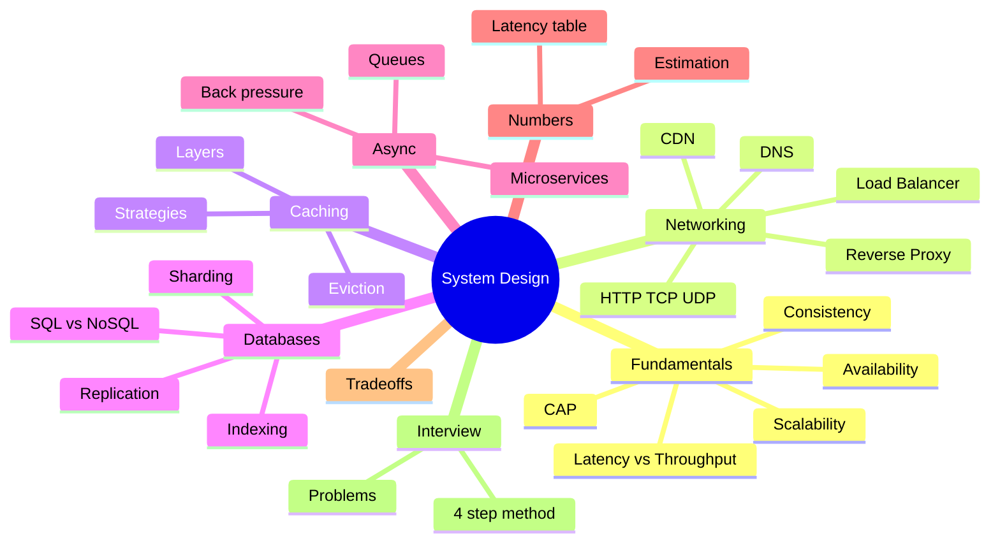
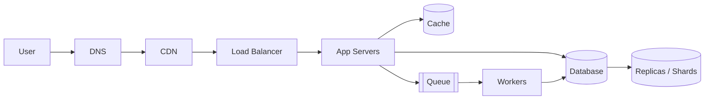

# System Design Course (Mind-Map Style)

Built for self-revision. Every file starts with a mind map, then short bullets, then **Connects to** links so you see how topics depend on each other.

## Master Mind Map

## How the pieces connect (request flow)

- Read it left to right: each box is a chapter, each arrow is a dependency.
- If a box is slow, the fix usually lives in the box next to it (cache before DB, replicas behind DB, queue behind app).

## Study Order

| # | File | Why this order |
|---|------|----------------|
| 1 | `01-fundamentals.md` | Vocabulary everything else uses |
| 2 | `06-estimation-and-numbers.md` | Needed to justify any design choice |
| 3 | `02-networking-and-load-balancing.md` | Front door of the system |
| 4 | `03-caching.md` | First scaling lever |
| 5 | `04-databases.md` | Hardest and most asked |
| 6 | `05-async-and-microservices.md` | Decoupling and scale-out |
| 7 | `07-tradeoffs.md` | Forces reasoning, not memory |
| 8 | `problems/*` | Apply everything |
| 9 | `08-interview-playbook.md` | Structure for answering |
| 10 | `09-revision-cheatsheet.md` | Final revision |

## Learning Loop (per topic)

- Ask 3 questions: **What problem does it solve? What does it cost? When would I NOT use it?**
- Close the file, explain it out loud for 2 minutes.
- Redraw the mind map from memory.
- Revise on day 1, 3, 7, 14.

## Progress Checklist

- [ ] 01 Fundamentals
- [ ] 06 Estimation
- [ ] 02 Networking
- [ ] 03 Caching
- [ ] 04 Databases
- [ ] 05 Async and Microservices
- [ ] 07 Tradeoffs
- [ ] Problem: Pastebin
- [ ] Problem: Twitter Timeline
- [ ] Problem: Web Crawler
- [ ] Problem: Rate Limiter
- [ ] 08 Interview Playbook
- [ ] 09 Revision Cheatsheet

> Source base: concepts follow *The System Design Primer* (donnemartin). Added depth: costs, failure cases, and "when not to use".
