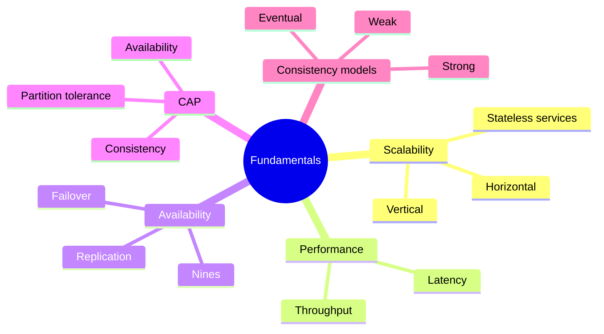

# 01 Fundamentals

## Scalability
- **Vertical:** bigger machine. Simple, but has a ceiling and is a single point of failure.
- **Horizontal:** more machines. Needs a load balancer and stateless servers.
- **Stateless service:** no user data kept in server memory, so any server can handle any request.
  - Session data goes to cache or DB.
- **Not needed when:** traffic is small. Do not shard a 10 GB database.

## Latency vs Throughput
- **Latency:** time for one request (ms).
- **Throughput:** requests per second.
- Goal: max throughput with acceptable latency.
- They trade off: batching raises throughput but adds latency.
- Use percentiles (p50, p95, p99), not averages. Tail latency hurts users.

## Availability
- Percentage of time the system works.
  - 99.9% = about 8.8 hours down/year
  - 99.99% = about 52 minutes/year
- **Availability in sequence:** multiply (two 99.9% parts in a row = 99.8%).
- **Availability in parallel:** `1 - (1-A)(1-B)`, much higher.
- Patterns:
  - **Active-passive failover:** standby takes over. Some downtime, data may lag.
  - **Active-active:** both serve traffic. Needs conflict handling.
- Cost: each extra nine multiplies cost and complexity.

## CAP Theorem
- During a network **Partition**, you pick **C** or **A**.
  - **CP:** refuse requests rather than return stale data (banking, inventory).
  - **AP:** answer with possibly stale data (feeds, likes).
- Partitions are unavoidable, so the real choice is C vs A.
- Common mistake: saying "CA system". Without partition tolerance a distributed system is not realistic.
- Trade-off lives in: [04-databases](04-databases.md).

## Consistency Patterns
- **Weak:** reads may not see recent writes (VoIP, live video, games).
- **Eventual:** replicas converge after some time (DNS, email, most NoSQL).
- **Strong:** reads always see the latest write (RDBMS, transactions).
- Cost: stronger consistency means higher latency and lower availability.

## Connects to
- Scalability → [02 load balancers](02-networking-and-load-balancing.md), [05 microservices](05-async-and-microservices.md)
- Availability → [04 replication](04-databases.md)
- CAP and consistency → [04 SQL vs NoSQL](04-databases.md), [07 tradeoffs](07-tradeoffs.md)
- Latency → [03 caching](03-caching.md), [06 numbers](06-estimation-and-numbers.md)
