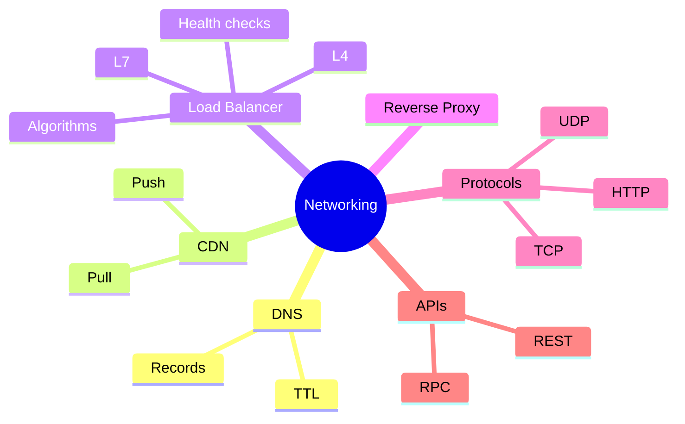

# 02 Networking and Load Balancing

## DNS
- Translates domain to IP.
- Records: **A** (name to IP), **CNAME** (alias), **NS** (name server), **MX** (mail).
- **TTL:** how long answers are cached. Low TTL = faster failover, more DNS load.
- Can route by latency, geography, weight (used for global traffic).
- Cost: caching delays changes, DNS itself can be a failure point.

## CDN
- Servers near users that serve static files (images, JS, video).
- **Push CDN:** you upload content. Good for small, rarely changing content.
- **Pull CDN:** fetches from origin on first request, then caches. Less maintenance, first request slow.
- Wins: lower latency, less origin load.
- Costs: stale content, invalidation, per-GB fees.
- Not needed when: users are in one region and content is dynamic.

## Load Balancer
- Spreads requests across servers, removes dead ones (**health checks**).
- **L4:** routes by IP/port. Fast, content-blind.
- **L7:** routes by URL, headers, cookies. Flexible, more CPU.
- Algorithms:
  - Round robin: simple, ignores load
  - Least connections: good for uneven requests
  - IP hash / consistent hashing: same client, same server
- Risk: the LB is a single point of failure. Run pairs (active-passive).
- **Sticky sessions:** avoid. They break even load and failover. Prefer stateless servers.

## Reverse Proxy
- Sits in front of servers: SSL termination, compression, caching, hides internals.
- Load balancer = a reverse proxy focused on distribution.
- Cost: extra hop, extra failure point.

## Protocols
- **TCP:** reliable, ordered, handshake. Web, DB, file transfer.
- **UDP:** fast, no guarantees. Video calls, games, DNS.
- **HTTP:** request/response on top of TCP.

## REST vs RPC
- **REST:** resources and verbs (GET /users/1). Cacheable, easy for public APIs.
- **RPC (gRPC):** call functions, binary, fast. Good for internal service calls.
- Pick: public → REST, internal high-volume → RPC.

## Connects to
- LB needs stateless servers → [01 scalability](01-fundamentals.md)
- CDN is a cache layer → [03 caching](03-caching.md)
- Service discovery behind LB → [05 microservices](05-async-and-microservices.md)
