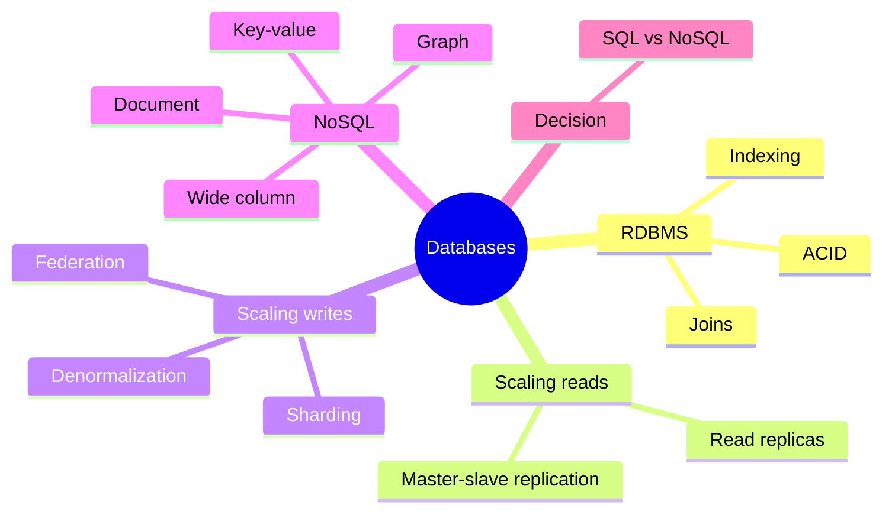

# 04 Databases

## RDBMS and ACID
- **Atomicity:** all or nothing. **Consistency:** valid state to valid state. **Isolation:** concurrent transactions do not interfere. **Durability:** committed data survives crashes.
- Strong consistency, joins, mature tooling.
- Cost: harder to scale writes horizontally.

## Indexing
- Index = sorted structure (usually B-tree) for fast lookups.
- Speeds reads, slows writes, uses memory.
- Index columns used in WHERE, JOIN, ORDER BY.
- Not worth it: tiny tables, write-heavy tables.

## Scaling Reads: Replication
- **Master-slave:** master takes writes, replicas copy and serve reads.
  - Risk: replication lag means stale reads.
  - Risk: master dies, a replica must be promoted (data loss possible).
- **Master-master:** both accept writes. Needs conflict resolution. Complex.

## Scaling Writes
- **Federation:** split by function (users DB, orders DB). Simple, but cross-DB joins are hard.
- **Sharding:** split the same table across machines by a key.
  - Strategies: hash of key (even spread), range (hot spots), directory (flexible, extra lookup).
  - **Consistent hashing:** adding a node moves few keys.
  - Costs: cross-shard joins and transactions are painful, rebalancing is hard, hot shards.
  - Do it last. Try cache, replicas, and indexes first.
- **Denormalization:** duplicate data to avoid joins. Faster reads, harder writes, risk of inconsistency.

## NoSQL Types
- **Key-value:** Redis, DynamoDB. Fast, simple lookups.
- **Document:** MongoDB. Flexible JSON, nested data.
- **Wide column:** Cassandra, HBase. Huge write volume, time-series.
- **Graph:** Neo4j. Relationship queries (social graph).
- Usually BASE: Basically Available, Soft state, Eventual consistency.

## SQL vs NoSQL (decision)
- Choose **SQL** when: relations, transactions, ad-hoc queries, data integrity matter.
- Choose **NoSQL** when: massive scale, flexible schema, simple access patterns, low latency.
- Weak reasoning: "NoSQL is faster". It is faster only for the access patterns it is built for.
- Most real systems use both.

## Connects to
- CP vs AP → [01 CAP](01-fundamentals.md)
- Cache first → [03 caching](03-caching.md)
- Write-heavy load smoothed by queues → [05 async](05-async-and-microservices.md)
- Storage size and QPS → [06 estimation](06-estimation-and-numbers.md)
