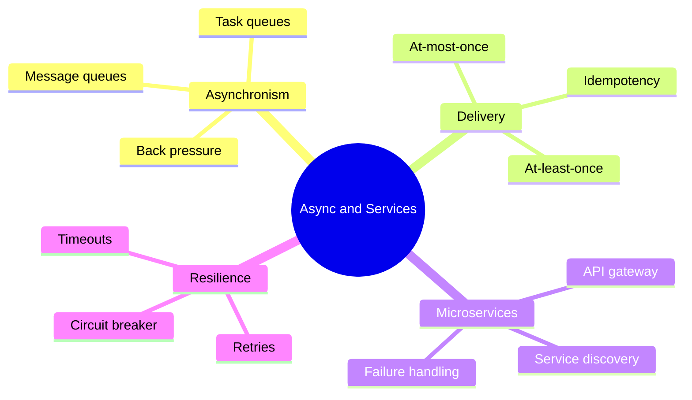

# 05 Async and Microservices

## Why async
- Slow work (email, video encoding) should not block the user request.
- Queues absorb traffic spikes and decouple producers from consumers.

## Message Queues
- Producer → queue → consumer(s). Examples: RabbitMQ, SQS, Kafka.
- **Task queue:** queue plus workers for jobs.
- Wins: smooths spikes, retry, independent scaling.
- Costs: eventual results, harder debugging, ordering issues.
- Not needed when: user must see the result immediately.

## Delivery Guarantees
- **At-most-once:** may lose messages.
- **At-least-once:** may duplicate. Most common.
- **Exactly-once:** very hard, usually faked with idempotency.
- **Idempotent operation:** doing it twice equals doing it once. Design consumers this way.

## Back Pressure
- Limit queue size, reject or slow producers when full.
- Without it: queue grows forever, memory fills, system collapses.
- Related: rate limiting, load shedding.

## Microservices
- Small independent services, each owning its data.
- Wins: independent deploy and scaling, fault isolation.
- Costs: network calls, distributed debugging, data consistency across services, operations overhead.
- Not worth it: small team or early product. A modular monolith is better.
- **Service discovery:** services find each other (Consul, etcd, Zookeeper) via registry and health checks.
- **API gateway:** single entry point for auth, routing, rate limiting.

## Resilience
- **Timeouts:** never wait forever.
- **Retries with backoff and jitter:** avoid retry storms.
- **Circuit breaker:** stop calling a failing service for a while.
- Failure chains: slow service → blocked threads → cascade.

## Connects to
- Load balancing in front of services → [02 networking](02-networking-and-load-balancing.md)
- Queues protect the DB → [04 databases](04-databases.md)
- Eventual consistency → [01 consistency](01-fundamentals.md)
- Used in: [Twitter timeline](problems/02-twitter-timeline.md), [Web crawler](problems/03-web-crawler.md)
