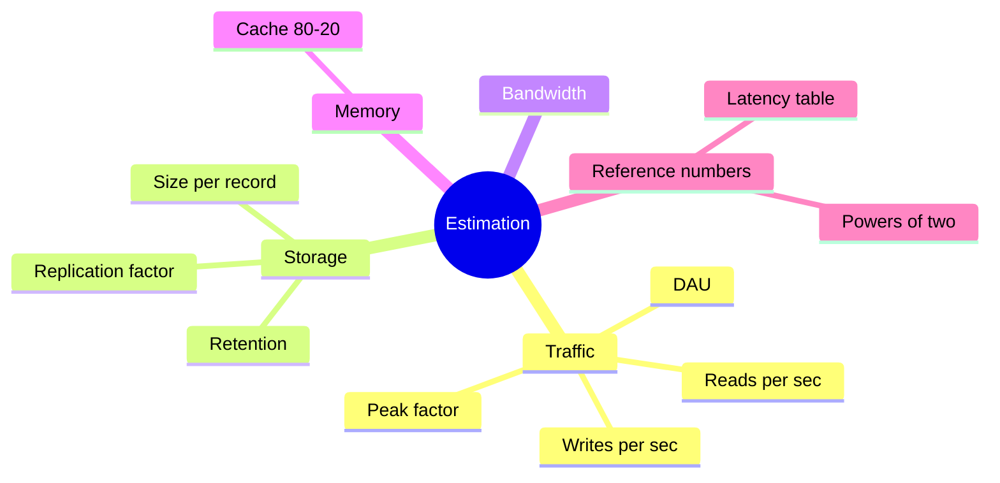

# 06 Estimation and Numbers

## Latency Numbers (order of magnitude)
- L1 cache: ~1 ns
- RAM read: ~100 ns
- SSD random read: ~100 µs
- Same datacenter round trip: ~0.5 ms
- HDD seek: ~10 ms
- Cross-continent round trip: ~150 ms
- Rules: memory is fast, disk is slow, network is slower, avoid cross-region calls in the hot path.

## Powers of Two
- 2^10 ≈ 1 thousand (KB), 2^20 ≈ 1 million (MB), 2^30 ≈ 1 billion (GB), 2^40 ≈ 1 trillion (TB).

## Time Shortcuts
- 1 day ≈ 86,400 s ≈ **10^5 s**.
- 1 million requests/day ≈ ~12 req/s.
- 2.5 million requests/month ≈ 1 req/s.
- Peak ≈ 2-10x average.

## 4-Step Estimation Method
- **1. Users:** DAU and actions per user per day.
- **2. QPS:** `DAU × actions / 86,400`, then multiply by peak factor.
- **3. Storage:** `writes/day × size × days retained × replication`.
- **4. Bandwidth and memory:** `QPS × payload size`; cache the hot 20% of data.

## Worked Example (Pastebin-like)
- 10M new pastes/month → ~4 writes/s.
- Read:write = 5:1 → ~20 reads/s.
- 1 KB per paste × 10M × 12 months × 3 years = ~360 GB.
- Conclusion: tiny QPS and modest storage, so a simple design with replicas works. No sharding needed yet.

## Why this matters
- Numbers decide the architecture: 20 QPS needs no cache, 200,000 QPS does.
- State assumptions out loud. Rough and justified beats exact and silent.

## Connects to
- Decides whether to shard → [04 databases](04-databases.md)
- Decides cache size → [03 caching](03-caching.md)
- Used in every [problem](problems/) and [interview playbook](08-interview-playbook.md)
