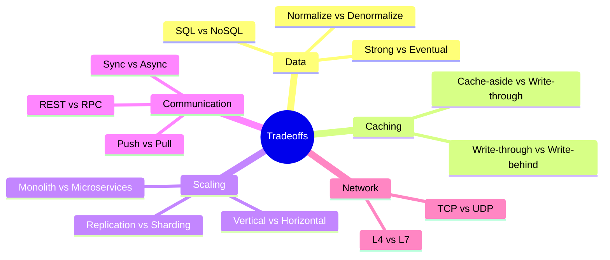

# 07 Tradeoffs

Format: **Choose A when** / **Choose B when** / **Hidden cost** / **When NOT to use**.

## SQL vs NoSQL
- A (SQL): relations, transactions, integrity.
- B (NoSQL): huge scale, flexible schema, simple queries.
- Hidden cost: SQL scales writes poorly; NoSQL loses joins and transactions.

## Replication vs Sharding
- Replication: scales **reads** and gives availability. Does not scale writes or storage.
- Sharding: scales **writes** and storage. Adds complexity.
- Order: indexes → cache → replicas → sharding.

## Cache-aside vs Write-through
- Cache-aside: read-heavy, tolerate stale briefly.
- Write-through: need fresh reads, accept slower writes.
- Write-behind: need fast writes, accept possible data loss.

## Vertical vs Horizontal Scaling
- Vertical: quick, simple, early stage.
- Horizontal: long-term, needs stateless design.

## Push vs Pull (feeds)
- **Push (fan-out on write):** precompute followers' timelines. Fast reads, slow writes, bad for celebrities.
- **Pull (fan-out on read):** compute at read time. Cheap writes, slow reads.
- **Hybrid:** push for normal users, pull for celebrities.

## Sync vs Async
- Sync: user needs the result now.
- Async: slow or bursty work. Cost: eventual results.

## Strong vs Eventual Consistency
- Strong: money, inventory.
- Eventual: feeds, counters, recommendations.

## Monolith vs Microservices
- Monolith: small team, early product.
- Microservices: many teams, independent scaling. Cost: operational overhead.

## L4 vs L7 LB
- L4: raw speed. L7: smart routing, more CPU.

## TCP vs UDP
- TCP: correctness. UDP: speed, loss is acceptable.

## Connects to
- Built from [01](01-fundamentals.md), [03](03-caching.md), [04](04-databases.md), [05](05-async-and-microservices.md)
- Used to justify choices in [problems](problems/) and the [interview playbook](08-interview-playbook.md)
