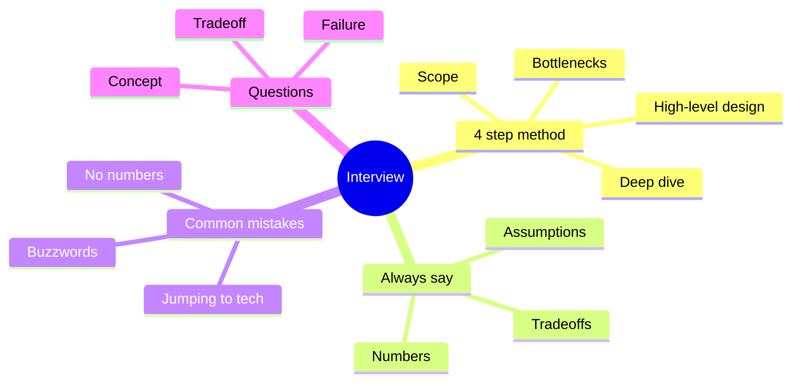

# 08 Interview Playbook

## The 4-Step Method
- **1. Scope (about 5 min):** ask questions, list functional and non-functional requirements, state assumptions, estimate ([06](06-estimation-and-numbers.md)).
- **2. High-level design (about 10 min):** draw boxes: client, LB, services, cache, DB, queue. Define APIs and data model.
- **3. Deep dive (about 15 min):** pick the 1-2 hardest parts (fan-out, key generation, sharding) and go deep.
- **4. Bottlenecks (about 5 min):** single points of failure, scaling limits, trade-offs, what you would improve.

## Rules
- Never say "I'd use Kafka" without saying why and what it costs.
- Every choice = **benefit + cost + alternative**.
- Think out loud. Silence looks like being stuck.
- If numbers are small, say a simple design is enough. Over-engineering is a failure.

## Common Questions with Short Answers
- **Q: SQL or NoSQL?** Depends on access pattern, relations, scale, consistency need. See [04](04-databases.md).
- **Q: How do you scale reads? Writes?** Reads: cache, replicas. Writes: sharding, queues.
- **Q: What if the cache goes down?** DB load spikes. Use replicas, rate limiting, warm-up, circuit breaker.
- **Q: How do you avoid a single point of failure?** Redundancy at every layer, health checks, failover.
- **Q: Explain CAP in practice.** During a partition choose consistency (reject) or availability (stale). See [01](01-fundamentals.md).
- **Q: How do you handle duplicates in a queue?** Idempotent consumers. See [05](05-async-and-microservices.md).
- **Q: What is consistent hashing for?** Adding/removing nodes moves few keys. See [04](04-databases.md).
- **Q: Why is a cache hard?** Invalidation and stampede. See [03](03-caching.md).
- **Q: Push or pull for a feed?** Hybrid. See [Twitter](problems/02-twitter-timeline.md).
- **Q: How would this fail?** Walk through each component dying and name the impact.

## Practice Plan
- Solve each [problem](problems/) on paper in 35 minutes without notes.
- Then compare with the file and list what you missed.
- Re-do problems you failed after 3 days.
