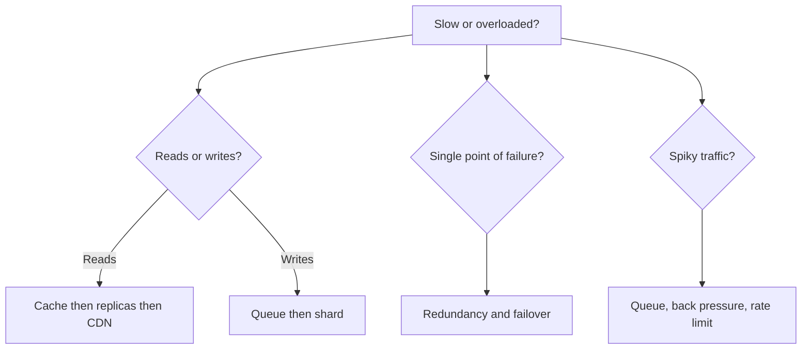

# 09 Revision Cheatsheet

## One-Page Mind Map

## Scaling Ladder (do in this order)
1. Indexes and query tuning
2. Cache
3. Read replicas
4. CDN for static
5. Queues for slow work
6. Sharding
7. Microservices

## Key Definitions
- **Latency:** time per request. **Throughput:** requests per second.
- **CAP:** in a partition choose C or A.
- **Eventual consistency:** replicas converge later.
- **Idempotent:** repeating gives the same result.
- **Back pressure:** slow or reject producers when overloaded.
- **Consistent hashing:** minimal key movement when nodes change.
- **Cache stampede:** hot key expires, DB flooded.
- **Fan-out:** one event produces many writes/reads.

## Numbers to Remember
- RAM ~100 ns, SSD ~100 µs, same-DC round trip ~0.5 ms, cross-continent ~150 ms.
- 1 day ≈ 10^5 s. 1M requests/day ≈ 12/s.
- 99.9% = 8.8 h/year down. 99.99% = 52 min/year.

## Flashcards (Q → A)
- Why avoid sticky sessions? → Breaks even load and failover.
- Replication scales what? → Reads and availability, not writes.
- Sharding scales what? → Writes and storage.
- Cache-aside weakness? → Stale data, slow first request.
- Write-behind risk? → Data loss before flush.
- Fixed-window rate limit flaw? → 2x burst at window edge.
- Hash vs range sharding? → Hash: even spread. Range: hot spots, but range queries work.
- Push vs pull feed? → Push: fast read, slow write. Pull: opposite.
- Why queue? → Absorb spikes, decouple, retry.
- Exactly-once reality? → At-least-once plus idempotency.
- When NOT microservices? → Small team, early product.
- When NOT shard? → Before cache, replicas, indexes.

## Last-Minute Checklist
- [ ] Stated requirements and assumptions
- [ ] Did the numbers
- [ ] Drew high-level diagram
- [ ] Justified each choice with a cost
- [ ] Found single points of failure
- [ ] Named bottlenecks and improvements
