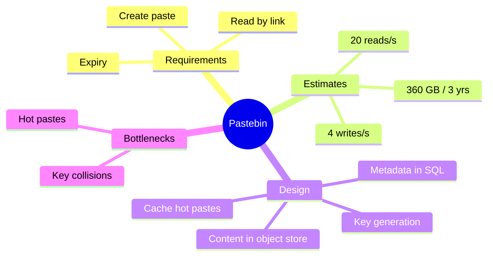

# Problem 1: Pastebin (also covers URL shortener)

## 1. Requirements
- Functional: create paste, get paste by URL, optional expiry.
- Non-functional: high availability for reads, low latency, unguessable links.

## 2. Estimates
- See [06 estimation](../06-estimation-and-numbers.md): ~4 writes/s, ~20 reads/s, ~360 GB over 3 years.

## 3. High-level design
- Client → [LB](../02-networking-and-load-balancing.md) → Write API / Read API.
- **Metadata** (key, owner, expiry, path) in SQL. **Content** in object storage.
- **Key generation:** hash (MD5 → base62, first 7 chars) or a pre-generated key service.
  - Hash risk: collisions. Handle by checking and retrying.
  - Key service: no collisions, but needs HA.
- Read path: [cache](../03-caching.md) first (cache-aside), then DB, then object store.
- Expiry: background job deletes expired rows and files.

## 4. Bottlenecks
- Hot paste → cache + CDN.
- Read volume → read replicas ([04](../04-databases.md)).
- Storage growth → object storage scales, shard metadata only if needed.
- Abuse → rate limiting ([problem 4](04-rate-limiter.md)).

## Trade-offs to mention
- SQL vs NoSQL for metadata: SQL is fine at this scale.
- Hash vs key service: simplicity vs collision-free.
