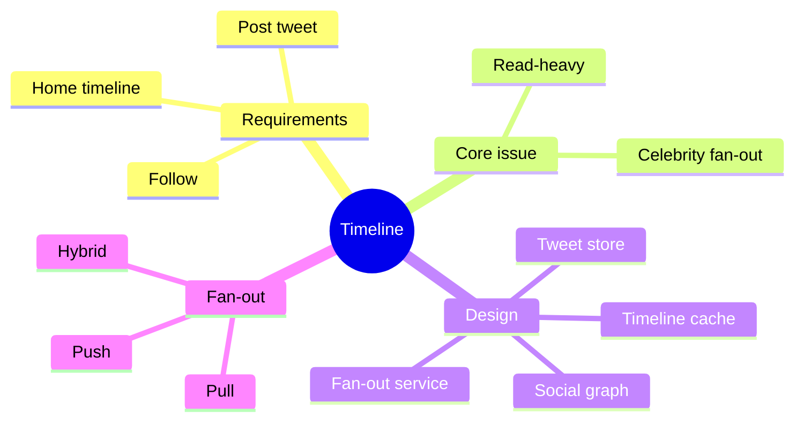

# Problem 2: Twitter Timeline

## 1. Requirements
- Post tweet, view home timeline, follow users, search (out of scope here).
- Read-heavy: timelines read far more than tweets are written. Latency matters most.

## 2. Estimates
- Example: 100M DAU, 5 timeline views/day → ~5,800 reads/s average, peak several times higher.
- Writes: 10M tweets/day → ~115/s.
- Fan-out cost: one tweet × 200 followers = 200 timeline writes.

## 3. Design
- Post → API → [queue](../05-async-and-microservices.md) → **Fan-out service** → writes tweet ID into each follower's timeline in [Redis cache](../03-caching.md).
- Tweet store (SQL or NoSQL), social graph store, user table.
- Read: fetch timeline IDs from cache, then hydrate tweets.
- **Hybrid fan-out:** push for normal users, pull and merge for celebrities ([07 tradeoffs](../07-tradeoffs.md)).

## 4. Bottlenecks
- Celebrity with 50M followers → never push, pull at read time.
- Inactive users → skip pushing, build on demand.
- Cache memory → keep only recent ~800 IDs per user.
- Fan-out lag → eventual consistency is acceptable ([01](../01-fundamentals.md)).
- Shard tweets by tweet ID or user ID ([04](../04-databases.md)).
