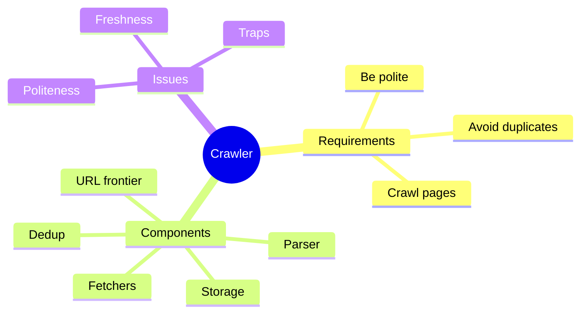

# Problem 3: Web Crawler

## 1. Requirements
- Crawl billions of pages, extract links, store content, avoid re-crawling same page, respect `robots.txt`.

## 2. Design
- **URL frontier** (queue of URLs to crawl) with priority and per-domain queues ([05 queues](../05-async-and-microservices.md)).
- **Fetcher workers** (scale horizontally) download pages.
- **Parser** extracts text and links.
- **Duplicate detection:**
  - URL seen? Use a Bloom filter or a key-value store.
  - Content seen? Compare page fingerprints (hash).
- **Storage:** raw pages in object storage, index/metadata in NoSQL ([04](../04-databases.md)).
- **DNS cache** to avoid repeated lookups ([02](../02-networking-and-load-balancing.md)).

## 3. Bottlenecks
- **Politeness:** one queue per domain with delay, so you do not hit a site too hard.
- **Crawler traps:** infinite URLs, so limit depth and URL length.
- **Freshness:** recrawl popular pages more often.
- **Scale:** partition URLs by domain hash across workers.
- Failure: workers crash → queue visibility timeouts and retries (idempotent processing).
