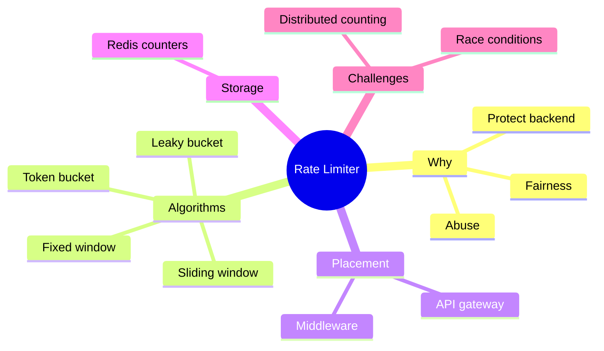

# Problem 4: Rate Limiter

## 1. Requirements
- Limit requests per user/IP/key (e.g., 100 per minute). Low added latency. Works across many servers.

## 2. Algorithms
- **Token bucket:** tokens refill at fixed rate, each request takes one. Allows bursts. Most common.
- **Leaky bucket:** processes at fixed rate. Smooths traffic.
- **Fixed window counter:** simple, but allows a 2x burst at window edges.
- **Sliding window:** accurate, more memory.

## 3. Design
- Place it at the [API gateway](../05-async-and-microservices.md) or middleware.
- Counters in [Redis](../03-caching.md) with TTL (fast, shared across servers).
- Return HTTP **429** with a `Retry-After` header.

## 4. Challenges
- **Race conditions:** use atomic increments or Lua scripts.
- **Distributed accuracy vs speed:** accept slightly loose limits for lower latency (AP choice, [01 CAP](../01-fundamentals.md)).
- **Redis down:** fail open (allow traffic) or fail closed (block). Pick based on risk.
- Different limits per tier or endpoint → rules config.
